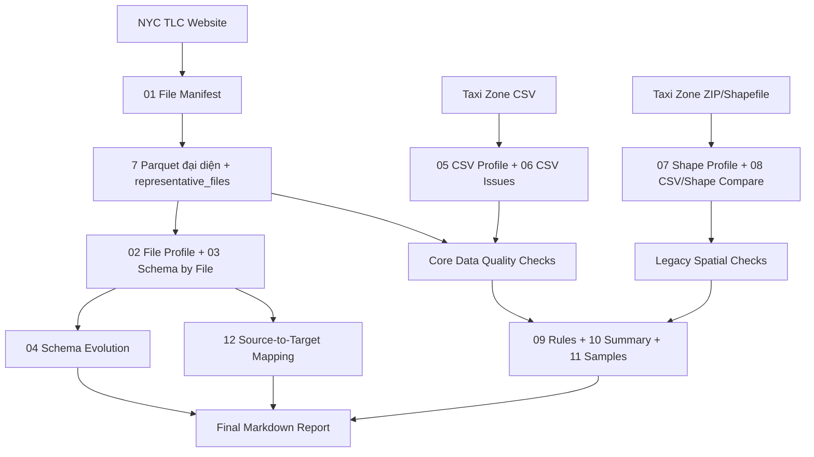

# 01. Tổng quan project NYC Yellow Taxi Survey

## 1. Project này làm gì?

Project khảo sát dữ liệu NYC Yellow Taxi trước khi nhóm thiết kế kho dữ liệu đa chiều (DDS). Mục tiêu chưa phải xây kho dữ liệu hoàn chỉnh, mà là trả lời bốn câu hỏi nền tảng:

1. Có những file nguồn nào và chúng có truy cập được không?
2. Schema thay đổi ra sao từ 2009 đến 2026?
3. Dữ liệu thô có những loại bất thường nào và mức độ bao nhiêu?
4. Cần chuẩn hóa trường nguồn thế nào để sau này nạp Staging và `fact_taxi_trip`?

Ba nguồn dữ liệu được dùng:

- **Yellow Taxi Trip Parquet:** nguồn giao dịch chính; mỗi dòng là một bản ghi chuyến đi.
- **Taxi Zone Lookup CSV:** danh mục mô tả `LocationID`, borough, zone và service zone.
- **Taxi Zone Shapefile:** polygon địa lý của taxi zone, dùng cho bản đồ và suy ra zone từ tọa độ cũ.

Khảo sát trước DDS là cần thiết vì schema thực tế không đồng nhất. Ví dụ, 2009–2010 dùng longitude/latitude; từ mẫu 2015 dùng `PULocationID`/`DOLocationID`; kiểu dữ liệu, cách viết hoa và các khoản phụ phí thay đổi theo năm. Nếu thiết kế fact/dimension dựa riêng vào dictionary hiện hành, ETL sẽ mất thông tin hoặc đọc sai file cũ.

Kết quả project gồm manifest 216 vị trí năm-tháng, 7 profile file đại diện, schema evolution, profile CSV/Shapefile, 40 DQ rule, 235 kết quả rule theo file, 404 mẫu dị thường, Source-to-Target Mapping và báo cáo cuối. Tổng số dòng đã quét ở bảy file là 60.108.247.

Các kết quả này hỗ trợ:

- chốt grain của `fact_taxi_trip`;
- xác định role-playing dimension pickup/dropoff date, time và zone;
- thiết kế canonical schema ở Staging;
- xây transformation theo phiên bản nguồn;
- quyết định reject, quarantine, map-to-unknown hoặc giữ-và-gắn-cờ;
- tạo test case ETL và kiểm thử cân bằng tiền, thời gian, location, duplicate.

## 2. Luồng xử lý tổng thể

| Bước | Input | Xử lý | Kết quả | Code thực hiện |
|---|---|---|---|---|
| Crawl | HTML TLC | Parse `<a href>`, regex tên file, HTTP HEAD | `01_yellow_taxi_file_manifest.csv` | `crawl_tlc_manifest.py`, `main()` dòng 28–60 |
| Chọn/tải | Manifest | Chọn tháng 1 hoặc tháng sớm nhất; tải stream; SHA-256 | 7 raw Parquet, `representative_files.csv` | `download_representative.py`, `download()` dòng 14–23, `main()` dòng 26–39 |
| Profile Parquet | 7 raw file | Đọc footer, schema, row group statistics | `02`, `03` | `profile_parquet.py`, `main()` dòng 11–33 |
| Schema evolution | `03` + mapping phiên bản | So tên, type, sự hiện diện | `04` | `generate_deliverables.py`, `schema_evolution()` dòng 16–33 |
| Profile lookup | Zone CSV | Null, distinct, duplicate, distribution, special values | `05`, `06` | `profile_taxi_zone_csv.py`, `main()` dòng 8–34 |
| Profile shape | ZIP/SHP + CSV | CRS, geometry, component, outer join LocationID | `07`, `08` | `profile_shapefile.py`, `main()` dòng 12–40 |
| Core DQ | Parquet + lookup | Canonical SQL, percentile, rule counts, duplicates | `10`, `11`, percentile | `run_data_quality_checks.py`, `base_sql()` dòng 33–43, `main()` dòng 46–88 |
| Spatial DQ | 2009/2010 + shape | Batch point creation, STRtree point-in-polygon | spatial summary; cập nhật `10`, `11` | `profile_legacy_spatial.py`, `scan_side()` dòng 17–31, `main()` dòng 34–49 |
| Sửa/giàu hóa | DQ outputs | Recompute duplicate; fee/date/location rules | cập nhật `10`, `11` | `recompute_duplicate_counts.py`; `enrich_temporal_fee_checks.py` |
| Tổng hợp | `03`, `10` và các profile | Rule registry, STM, report | `04`, `09`, `12`, report | `generate_deliverables.py`, `main()` dòng 213–216 |

## 3. Các quyết định quan trọng

### Chỉ chọn bảy file đại diện

Bảy mốc 2009, 2010, 2015, 2019, 2024, 2025, 2026 đại diện cho các bước đổi schema đáng chú ý. Project quét toàn bộ 60 triệu dòng trong các file này nhưng không tải 204 file, nhờ đó kiểm chứng sâu mà không tốn hàng chục GB và thời gian không cần thiết. Kết quả không được coi là đại diện thống kê cho mọi tháng; báo cáo ghi rõ hạn chế này.

### Dùng metadata Parquet

`pyarrow.parquet.ParquetFile` đọc footer để lấy row count, column count, row groups, schema, null count và min/max mà không đưa toàn bộ dữ liệu vào RAM (`profile_parquet.py:16–30`). Chỉ các truy vấn DQ mới quét toàn file bằng DuckDB.

### 2009–2010 cần spatial join

Hai schema này không có LocationID mà có pickup/dropoff longitude, latitude (`run_data_quality_checks.py:15–16`). Code chuyển polygon từ EPSG:2263 sang EPSG:4326, tạo Point và tra STRtree (`profile_legacy_spatial.py:36–45`).

### CSV 265 nhưng Shapefile 263

CSV có 265 LocationID duy nhất; Shapefile có 263 feature. Outer join trong `profile_shapefile.py:28–38` cho thấy LocationID 264 (Unknown) và 265 (Outside of NYC) chỉ có trong CSV. Đây là hợp lý vì hai giá trị danh mục này không nhất thiết có polygon thực.

### Không tự xóa giao dịch âm hoặc duplicate

Giá trị âm có thể là giao dịch đảo/điều chỉnh. Composite duplicate chỉ là hai dòng trùng bộ thuộc tính đã chọn, không chứng minh cùng một chuyến thật. Code chỉ đếm, lấy mẫu và khuyến nghị quarantine; không xóa raw (`run_data_quality_checks.py:80–84`).

### Total mismatch chỉ là cờ

`expected_total` cộng các thành phần tồn tại bằng `COALESCE(...,0)` (`run_data_quality_checks.py:40–43`). Nếu vendor để null một khoản phí nhưng đã cộng vào total, rule vẫn mismatch. Vì vậy `DQ-AMOUNT-006/007` cần điều tra, không phải bằng chứng chắc chắn rằng `total_amount` sai.

### Record hash không phải trip ID

Code hiện không tạo cột hash thực tế; báo cáo chỉ đề xuất dùng hash sau này để hỗ trợ duplicate detection. Một hash của composite fields không phải ID do TLC cấp và có thể trùng giữa hai chuyến thật.

## 4. Nên đọc gì tiếp?

1. `10_ONE_PAGE_CHEAT_SHEET.md` để nắm nhanh.
2. `02_DATA_ACQUISITION_WALKTHROUGH.md` để hiểu dữ liệu đến từ đâu.
3. `05_SCRIPT_WALKTHROUGH.md` và `06_EXECUTION_RUNBOOK.md` để chạy lại.
4. `07_DATA_QUALITY_EXPLAINED.md` và `08_DATA_LINEAGE.md` trước khi thiết kế DDS.
5. `11_CONSISTENCY_REVIEW.md` để biết các giới hạn của code hiện tại.
