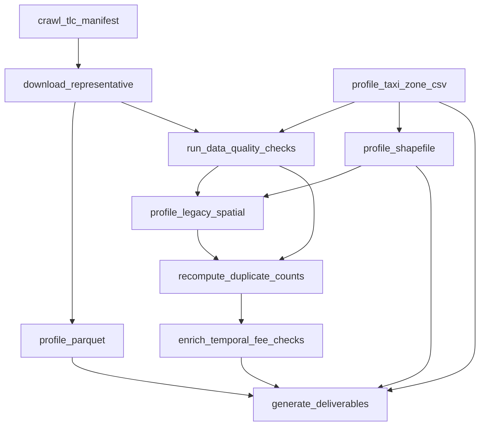

# 06. Execution Runbook

## 1. Chuẩn bị môi trường

Project đã chạy với Python 3.12.13. Từ PowerShell tại `D:\BI\DATH`:

```powershell
uv venv .venv --python 3.12
uv pip install --python .venv\Scripts\python.exe -r nyc_taxi_survey\requirements.txt
```

Không bắt buộc activate nếu luôn gọi đúng executable. Nếu muốn activate:

```powershell
.\.venv\Scripts\Activate.ps1
python --version
```

Chuẩn bị reference input:

```text
nyc_taxi_survey/data/reference/
├── taxi+_zone_lookup.csv
├── taxi_zones.zip
└── cq_BI_PROJECT_LAB_2627.pdf   # không bắt buộc đối với pipeline dữ liệu
```

`common.init_dirs()` sẽ tạo `data/raw`, `data/reference`, `data/sample`, các thư mục output và logs nếu thiếu. Không cần tự tạo chúng.

## 2. Quan hệ phụ thuộc



Giải thích:

- Manifest phải có trước download.
- `profile_parquet` và core DQ đều cần raw/representative list.
- CSV profile và Shapefile profile không cần raw; có thể chạy song song với Parquet profile sau khi môi trường sẵn sàng.
- Legacy spatial cần shape đã giải nén và core `10/11` đã tồn tại.
- Generator phải chạy cuối để report đọc số mới nhất.
- `common.py` không phải bước chạy.

## 3. Chạy lại toàn bộ

> Cảnh báo: không xóa raw. Download script sẽ reuse file non-zero. `profile_legacy_spatial.py` không idempotent đối với `10/11`: nếu chạy lặp mà không chạy core DQ trước, spatial rows/samples sẽ bị append lần nữa. Vì vậy full run luôn chạy core DQ trước spatial.

```powershell
.venv\Scripts\python.exe nyc_taxi_survey\scripts\crawl_tlc_manifest.py
.venv\Scripts\python.exe nyc_taxi_survey\scripts\download_representative.py
.venv\Scripts\python.exe nyc_taxi_survey\scripts\profile_parquet.py
.venv\Scripts\python.exe nyc_taxi_survey\scripts\profile_taxi_zone_csv.py
.venv\Scripts\python.exe nyc_taxi_survey\scripts\profile_shapefile.py
.venv\Scripts\python.exe nyc_taxi_survey\scripts\run_data_quality_checks.py
.venv\Scripts\python.exe nyc_taxi_survey\scripts\profile_legacy_spatial.py
.venv\Scripts\python.exe nyc_taxi_survey\scripts\recompute_duplicate_counts.py
.venv\Scripts\python.exe nyc_taxi_survey\scripts\enrich_temporal_fee_checks.py
.venv\Scripts\python.exe nyc_taxi_survey\scripts\generate_deliverables.py
```

Các bước 3, 4, 5 có thể chạy song song về mặt dependency, nhưng nên chạy tuần tự khi người mới vận hành để log dễ đọc. Core DQ và spatial là hai bước nặng nhất; không nên chạy đồng thời trên máy hạn chế RAM/I/O.

## 4. Chỉ tạo lại báo cáo từ kết quả hiện có

Nếu không thay đổi raw/profile/DQ:

```powershell
.venv\Scripts\python.exe nyc_taxi_survey\scripts\generate_deliverables.py
```

Script này sẽ ghi đè `04`, `09`, `12` và báo cáo. Nó không chạy lại dữ liệu thô. Phải chắc rằng `03`, `05`–`08`, `10`, percentile và spatial summary còn tồn tại.

## 5. Phân tích thêm một tháng Parquet mới

Code hiện được thiết kế cho danh sách bảy mốc cố định, chưa có CLI `--year/--month`. Quy trình an toàn:

1. Chạy lại manifest để kỳ mới xuất hiện.
2. Cập nhật có kiểm soát `YEARS`/logic lựa chọn trong `download_representative.py`, hoặc tạo một inventory riêng có cùng schema như `representative_files.csv`.
3. Thêm mapping schema năm tương ứng vào `CANON` nếu schema mới khác (`run_data_quality_checks.py:14–22`).
4. Tải file bằng download script.
5. Chạy profile Parquet và xem `03` trước khi chạy DQ.
6. Chạy core DQ; lưu ý script sẽ ghi đè `10/11` cho toàn danh sách representative.
7. Chạy spatial chỉ nếu file có coordinate schema được khai báo trong `COORDS`.
8. Chạy helper và generator.

Không nên chỉ chép một file vào `data/raw`: các script điều khiển theo `representative_files.csv`, không tự quét mọi file trong thư mục.

## 6. Kiểm tra sau khi chạy

### Manifest

```powershell
(Import-Csv nyc_taxi_survey\outputs\profiles\01_yellow_taxi_file_manifest.csv).Count
Import-Csv nyc_taxi_survey\outputs\profiles\01_yellow_taxi_file_manifest.csv |
  Group-Object access_status | Select-Object Name,Count
```

Kỳ vọng hiện tại: 216 dòng; 204 `ok`, 12 `missing_from_page`.

### Raw và checksum

```powershell
Get-ChildItem nyc_taxi_survey\data\raw\*.parquet | Select-Object Name,Length
Import-Csv nyc_taxi_survey\outputs\profiles\representative_files.csv |
  Select-Object file_name,downloaded_size_bytes,sha256
```

Phải có 7 file. Code hiện không có lệnh verify checksum tự động; muốn kiểm lại có thể dùng PowerShell `Get-FileHash -Algorithm SHA256` và so với cột `sha256`.

```powershell
Get-FileHash nyc_taxi_survey\data\raw\*.parquet -Algorithm SHA256
```

### Output 01–12

```powershell
Get-ChildItem -Recurse nyc_taxi_survey\outputs -File |
  Select-Object FullName,Length
```

Kỳ vọng mọi file 01–12 tồn tại và size > 0. Ngoài ra cần `representative_files.csv`, `distribution_percentiles.csv`, `legacy_spatial_summary.csv` và final report.

### CSV có header/dữ liệu

```powershell
Import-Csv nyc_taxi_survey\outputs\anomalies\10_anomaly_summary.csv |
  Select-Object -First 3
```

### Parquet mẫu đọc được

```powershell
.venv\Scripts\python.exe -c "import pyarrow.parquet as pq; p=pq.ParquetFile(r'nyc_taxi_survey/outputs/anomalies/11_anomaly_samples.parquet'); print(p.metadata.num_rows,p.schema_arrow)"
```

Kỳ vọng hiện tại: 404 sample rows.

### Log không có dấu hiệu thiếu bước

```powershell
Get-ChildItem nyc_taxi_survey\logs\*.log |
  ForEach-Object { $_.Name; Get-Content $_.FullName -Tail 3 }
```

Log chỉ ghi INFO/WARNING do logger cấu hình. Exception có thể chỉ xuất hiện ở console, nên phải kiểm tra exit code khi automation.

### Báo cáo cập nhật

```powershell
Get-Item nyc_taxi_survey\outputs\reports\NYC_Yellow_Taxi_Source_Survey_and_Data_Quality_Report.md |
  Select-Object LastWriteTime,Length
```

## 7. Khắc phục lỗi nhanh

| Triệu chứng | Nguyên nhân có thể | Xử lý |
|---|---|---|
| `.part` còn lại | Download bị ngắt | Kiểm tra target chính; rerun download, script tải lại từ đầu |
| `iloc[0] out of bounds` | Năm không có candidate trong manifest | Kiểm tra `01`, không tự đoán URL |
| `FileNotFoundError` | Sai run order/reference thiếu | Đối chiếu dependency diagram |
| DuckDB out of memory/chậm | Duplicate GROUP BY/file lớn | Đóng ứng dụng khác; không chạy spatial song song |
| CRS/column error | Shape thiếu component/schema đổi | Kiểm tra `07` và component names |
| Spatial rows bị lặp | Chạy spatial nhiều lần | Chạy lại core DQ trước spatial để reset `10/11` |
| Report dùng số cũ | Upstream chưa rerun | Chạy lại profile/DQ cần thiết rồi generator cuối |
