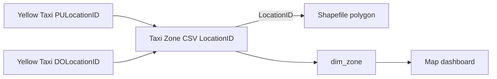
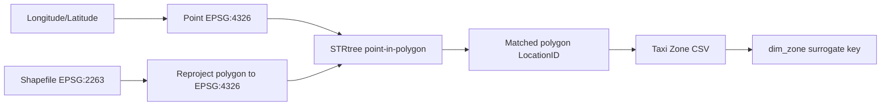

# 08. Data lineage và liên kết ba nguồn

## 1. Yellow Taxi Trip

Đây là nguồn giao dịch chính. Theo grain dự kiến, một dòng fact biểu diễn một bản ghi chuyến Yellow Taxi từ meter-on đến meter-off. Raw source chưa có trip ID chính thức, nên source row phải giữ lineage bằng file, year-month và sau này nên thêm row-group/row-number.

### Measure tiềm năng

- `trip_count = 1`;
- passenger count;
- trip distance;
- duration và average speed được dẫn xuất;
- fare, extra, mta tax, tip, tolls, improvement/congestion/airport/CBD fee, total.

### Foreign key tiềm năng

- pickup/dropoff date và time;
- pickup/dropoff zone;
- vendor;
- payment type;
- rate code.

## 2. Taxi Zone CSV

CSV là master/reference nhỏ cho zone. `LocationID` nối với `PULocationID` và `DOLocationID`. Nó cung cấp `Borough`, `Zone`, `service_zone`, phù hợp làm thuộc tính `dim_zone`.

Cùng một `dim_zone` được dùng hai vai trò:

- Pickup Zone;
- Dropoff Zone.

Không cần hai bảng zone vật lý; fact có hai foreign keys tới cùng dimension.

## 3. Taxi Zone Shapefile

Shape cung cấp polygon và thuộc tính không gian. Nó không phải fact vì mỗi feature là một vùng danh mục tương đối ổn định, không phải một giao dịch.

Vai trò:

- suy ra LocationID cho 2009–2010 từ longitude/latitude;
- vẽ choropleth/bubble/pickup-dropoff map;
- kiểm tra điểm ngoài zone hoặc boundary;
- gắn geometry vào/hoặc liên kết geometry với `dim_zone`.

## 4. Quan hệ dữ liệu mới



Từ mẫu 2015 trở đi, trip đã có LocationID. ETL kiểm membership trực tiếp trong 265 IDs, map surrogate key và giữ ID 264/265 như các member đặc biệt theo policy.

## 5. Quan hệ dữ liệu cũ



Code thực tế thực hiện đến bước đếm match/unmatched và lấy sample (`profile_legacy_spatial.py:17–49`). Nó **không** xuất bảng từng trip với `derived_location_id`; bước đó còn phải được xây trong ETL production.

## 6. Lineage từ source đến output

```text
TLC HTML
  └─ 01 manifest
      └─ representative_files + SHA-256
          └─ data/raw/*.parquet
              ├─ 02 file profile
              ├─ 03 schema by file ──> 04 evolution ──> 12 STM
              └─ 10 anomaly summary ──> 09 rule registry / final report
                                       └─ 11 bounded samples

Taxi Zone CSV
  ├─ 05 profile / 06 issues
  ├─ membership check in 10
  └─ outer join with shape ──> 08 comparison

Taxi Zone ZIP
  └─ extracted shape ──> 07 profile
                       └─ legacy spatial summary / DQ-SPATIAL
```

## 7. Source → Staging → DDS

### Source

Raw Parquet, lookup CSV, shape ZIP/components; giữ nguyên và có checksum/URL.

### Staging đề xuất

- canonical field names;
- source values/lineage;
- schema version;
- native LocationID tách khỏi spatial-derived LocationID;
- cast/DQ flags;
- không xóa reversal/duplicate candidate tự động.

### DDS đề xuất

- `fact_taxi_trip` theo grain chuyến;
- `dim_date`, `dim_time`, `dim_zone`, `dim_vendor`, `dim_payment_type`, `dim_rate_code`;
- role-playing pickup/dropoff date/time/zone;
- Unknown surrogate member để xử lý null/unmatched theo chính sách.

### Dashboard

Fact cung cấp measure; `dim_zone` cung cấp tên/borough/service zone; geometry cung cấp polygon. Web map cần geometry EPSG:4326 hoặc hệ CRS được công cụ BI hỗ trợ.
