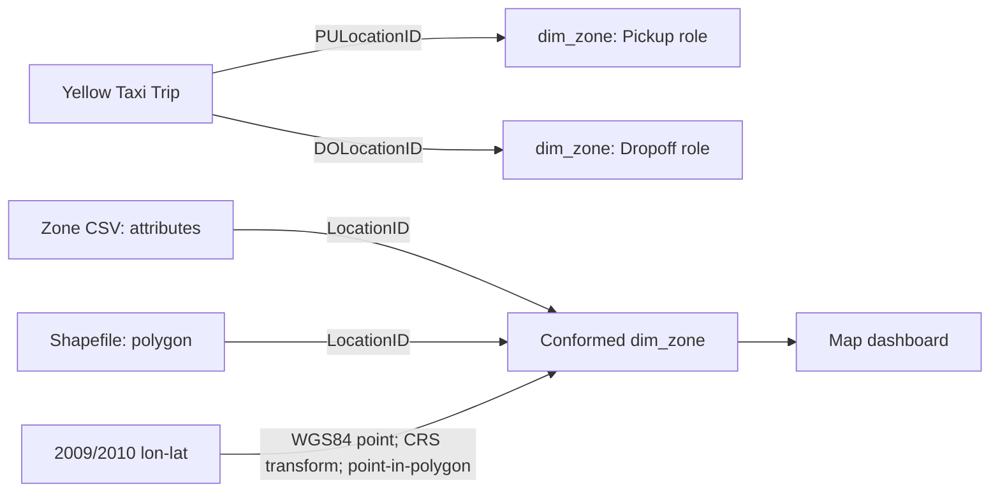
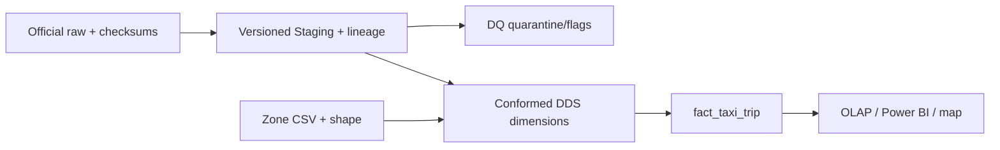

# NYC Yellow Taxi Source Survey and Data Quality Report

**Ngày truy cập/kiểm tra:** 2026-10-30 (Asia/Bangkok)  
**Nguồn chính:** https://www.nyc.gov/site/tlc/about/tlc-trip-record-data.page  
**Phạm vi:** Yellow Taxi 2009-2026; 7 file đại diện; Taxi Zone CSV và Shapefile đính kèm.

## 1. Executive Summary

Khảo sát đọc metadata của 7 file Parquet đại diện và chạy truy vấn tổng hợp toàn bộ **60,108,247 dòng**. Trang TLC cung cấp **204** link tháng Yellow Taxi trong khung 2009-2026 tại ngày kiểm tra; **12** vị trí năm-tháng chưa có link trên trang, không được tự diễn giải là mất dữ liệu nếu đó là tháng tương lai/chưa công bố. TLC lưu ý dữ liệu do nhà cung cấp công nghệ gửi và không bảo đảm độ chính xác.

Các vị trí không có anchor trong HTML crawl: 2023-05, 2023-07 đến 2023-11; 2024-01 đến 2024-03; và 2026-10 đến 2026-12. Đây là kết quả crawl trang tại ngày kiểm tra, không phải khẳng định file vật lý không tồn tại; cần điều tra riêng nếu backfill production.

Schema không ổn định xuyên suốt giai đoạn. Hai file 2009/2010 dùng tọa độ; từ file 2015 đại diện dùng `PULocationID`/`DOLocationID`. `Airport_fee` khác chữ hoa so với dictionary; `cbd_congestion_fee` chỉ có từ 2025 trong mẫu. Vì vậy Staging phải version-aware và giữ lineage, không union theo vị trí cột.

## 2. Phạm vi và phương pháp

- Crawl duy nhất trang TLC và URL liên kết trực tiếp; manifest chứa cả ô tháng không có link.
- Chọn tháng 1 nếu manifest có; 2024 dùng tháng 4 vì tháng 1-3 không được parser manifest nhận diện tại lần crawl, đã ghi selection reason.
- PyArrow đọc footer, schema, row-group statistics. DuckDB quét toàn file để tính DQ và percentile. Không sửa raw.
- Ngưỡng duration/distance/speed dùng P99 quan sát của từng file như cờ thống kê; không khẳng định mọi dòng trên P99 là sai.
- Domain mã theo phiên bản; domain dictionary 2025 không áp ngược cho 2009/2010.

Tài liệu đồ án yêu cầu phân tích chuyến/hành khách theo thời gian, doanh thu theo borough/vendor, payment, pickup/dropoff, nhóm hành khách/rate/distance, tuyến phổ biến, tip và tốc độ. Các yêu cầu này là căn cứ cho grain, fact và dimension dưới đây.

## 3. Danh mục nguồn

| Nguồn | URL tải/chứng cứ | Vai trò |
|---|---|---|
| TLC Trip Record Data | https://www.nyc.gov/site/tlc/about/tlc-trip-record-data.page | Trang gốc/crawl manifest |
| Yellow dictionary (18-03-2025) | https://www.nyc.gov/assets/tlc/downloads/pdf/data_dictionary_trip_records_yellow.pdf | Ý nghĩa trường và domain hiện hành |
| Trip Record User Guide | https://www.nyc.gov/assets/tlc/downloads/pdf/trip_record_user_guide.pdf | Grain và lịch sử nguồn |
| Working With Parquet | https://www.nyc.gov/assets/tlc/downloads/pdf/working_parquet_format.pdf | Hướng dẫn định dạng |
| Taxi Zone lookup | https://d37ci6vzurychx.cloudfront.net/misc/taxi_zone_lookup.csv | Dimension mô tả |
| Taxi Zone shapefile | https://d37ci6vzurychx.cloudfront.net/misc/taxi_zones.zip | Geometry không gian |

## 4. Khảo sát Yellow Taxi Parquet

| file                            |   size_bytes |   row_groups |   total_rows |   num_columns |   read_metadata_seconds | status   |
|:--------------------------------|-------------:|-------------:|-------------:|--------------:|------------------------:|:---------|
| yellow_tripdata_2009-01.parquet |    469759995 |            1 |     14092413 |            18 |                0.015585 | readable |
| yellow_tripdata_2010-01.parquet |    515402953 |            1 |     14863778 |            18 |                0.001362 | readable |
| yellow_tripdata_2015-01.parquet |    175325767 |            1 |     12741035 |            19 |                0.001112 | readable |
| yellow_tripdata_2019-01.parquet |    110439634 |            1 |      7696617 |            19 |                0.000841 | readable |
| yellow_tripdata_2024-04.parquet |     59133625 |            4 |      3514289 |            19 |                0.000743 | readable |
| yellow_tripdata_2025-01.parquet |     59158238 |            4 |      3475226 |            20 |                0.000637 | readable |
| yellow_tripdata_2026-01.parquet |     64165080 |            4 |      3724889 |            20 |                0.000596 | readable |

Chi tiết từng cột, physical/logical type, nullable, min/max và null count từ metadata nằm ở `03_schema_by_file.csv`. Nullability của Arrow là khả năng schema, khác với null count quan sát.

## 5. Schema evolution 2009-2026

- 2009: 18 cột, tên như `vendor_name`, `Trip_Pickup_DateTime`, tọa độ `Start_Lon/Lat`; datetime vật lý/logical là string.
- 2010: 18 cột nhưng đổi tên/case (`vendor_id`, `pickup_datetime`, `pickup_longitude`); rate từ double sang string trong mẫu.
- 2015: 19 cột; datetime timestamp, LocationID thay tọa độ, có improvement surcharge; congestion/airport là logical null.
- 2019: passenger/rate đổi sang double; congestion có double, airport vẫn null.
- 2024: integer width thay đổi; `store_and_fwd_flag` large_string; `Airport_fee` viết hoa A.
- 2025-2026: 20 cột và thêm `cbd_congestion_fee`, phù hợp thông báo TLC về dữ liệu từ 2025.

Bảng canonical đầy đủ: `04_schema_evolution.csv`. Quy tắc cốt lõi: cast vào cột canonical nhưng đồng thời giữ `source_file`, `source_year_month`, `source_field`, raw value khi cast lỗi và `schema_version`.

## 6. Taxi Zone CSV

CSV có 265 dòng, 4 cột. `LocationID` phải được kiểm chứng theo membership; không suy ra hợp lệ từ min/max. Có 27 dòng issue/special-case được ghi trong `06_taxi_zone_lookup_issues.csv`; một phần là airport/Unknown/N/A/Outside NYC được chủ động liệt kê, không đồng nghĩa lỗi.

## 7. Taxi Zone Shapefile

- Feature: **263**; geometry: **MultiPolygon|Polygon**; CRS: **EPSG:2263**.
- Geometry null/empty/invalid: **0/0/0**.
- CSV có 265 dòng, shapefile 263 feature; bảng outer comparison có **2** dòng mang cờ khác biệt hoặc chỉ ở một nguồn.
- CRS nguồn phải được bảo toàn; tạo derivative EPSG:4326 cho web map. Spatial join nên thực hiện trong CRS phù hợp và dùng `covers` nếu muốn tính điểm trên biên.

## 8. Liên kết ba nguồn

Với dữ liệu cũ: kiểm tra/null-zero/range tọa độ, tạo Point EPSG:4326, chuyển polygon về cùng CRS, point-in-polygon, ghi `spatial_match_count`, `derived_location_id`, cờ unmatched/multiple/boundary. Không tự gán điểm ngoài polygon.

## 9. Dị thường dữ liệu

Top kết quả theo số dòng vi phạm (các rule P99 là cờ thống kê, luôn xấp xỉ 1%):

| file                            | rule_id          |   checked_rows |   failed_rows | failed_rate   | severity   |
|:--------------------------------|:-----------------|---------------:|--------------:|:--------------|:-----------|
| yellow_tripdata_2009-01.parquet | DQ-CODE-002      |       14092413 |      14092413 | 100.0000%     | Medium     |
| yellow_tripdata_2026-01.parquet | DQ-AMOUNT-006    |        3724889 |       1432812 | 38.4659%      | Medium     |
| yellow_tripdata_2026-01.parquet | DQ-AMOUNT-007    |        3724889 |       1432500 | 38.4575%      | Medium     |
| yellow_tripdata_2025-01.parquet | DQ-AMOUNT-006    |        3475226 |       1111807 | 31.9924%      | Medium     |
| yellow_tripdata_2025-01.parquet | DQ-AMOUNT-007    |        3475226 |       1111802 | 31.9922%      | Medium     |
| yellow_tripdata_2026-01.parquet | DQ-CODE-002      |        3724889 |       1088058 | 29.2105%      | Medium     |
| yellow_tripdata_2026-01.parquet | DQ-PASSENGER-001 |        3724889 |       1088058 | 29.2105%      | Medium     |
| yellow_tripdata_2024-04.parquet | DQ-AMOUNT-006    |        3514289 |       1074428 | 30.5731%      | Medium     |
| yellow_tripdata_2024-04.parquet | DQ-AMOUNT-007    |        3514289 |       1074428 | 30.5731%      | Medium     |
| yellow_tripdata_2015-01.parquet | DQ-AMOUNT-006    |       12741035 |        691080 | 5.4240%       | Medium     |
| yellow_tripdata_2015-01.parquet | DQ-AMOUNT-007    |       12741035 |        691069 | 5.4240%       | Medium     |
| yellow_tripdata_2025-01.parquet | DQ-PASSENGER-001 |        3475226 |        540149 | 15.5428%      | Medium     |
| yellow_tripdata_2025-01.parquet | DQ-CODE-002      |        3475226 |        540149 | 15.5428%      | Medium     |
| yellow_tripdata_2024-04.parquet | DQ-CODE-002      |        3514289 |        408576 | 11.6261%      | Medium     |
| yellow_tripdata_2024-04.parquet | DQ-PASSENGER-001 |        3514289 |        408576 | 11.6261%      | Medium     |
| yellow_tripdata_2024-04.parquet | DQ-CODE-006      |        3514289 |        408576 | 11.6261%      | Medium     |
| yellow_tripdata_2015-01.parquet | DQ-LOCATION-004  |       12741035 |        290547 | 2.2804%       | Medium     |
| yellow_tripdata_2010-01.parquet | DQ-SPATIAL-001   |       14863778 |        268264 | 1.8048%       | Medium     |
| yellow_tripdata_2010-01.parquet | DQ-SPATIAL-001   |       14863778 |        263010 | 1.7695%       | Medium     |
| yellow_tripdata_2010-01.parquet | DQ-AMOUNT-007    |       14863778 |        235967 | 1.5875%       | Medium     |

Percentile theo file:

| file                            |   dur_p50 |   dur_p90 |   dur_p95 |   dur_p99 |   dur_max |   dist_p99 |   speed_p99 |       speed_max |
|:--------------------------------|----------:|----------:|----------:|----------:|----------:|-----------:|------------:|----------------:|
| yellow_tripdata_2009-01.parquet |    9      |   20.0833 |   25.15   |   39.7    |  60554.8  |      17.1  |     44.7    | 59580           |
| yellow_tripdata_2010-01.parquet |    9      |   20      |   25      |   38      |  20170.5  |      17.39 |     36.5265 | 64800           |
| yellow_tripdata_2015-01.parquet |    9.95   |   23.45   |   29.5833 |   46.7667 | 548556    |      18.22 |     36.1165 |     2.02838e+08 |
| yellow_tripdata_2019-01.parquet |   10.1833 |   25.65   |   33.1167 |   53.7167 |  43648    |      18.96 |     36.0442 | 73440           |
| yellow_tripdata_2024-04.parquet |   12.8    |   31.75   |   42.0833 |   67.5333 |   9767.52 |      19.87 |     34.8407 |     5.37916e+06 |
| yellow_tripdata_2025-01.parquet |   11.7    |   27.55   |   36.2    |   58.9167 |   5626.32 |      19.5  |     35.5423 |     3.7225e+06  |
| yellow_tripdata_2026-01.parquet |   13.3667 |   32.25   |   42.75   |   71.4333 |   7507.9  |      19.54 |     35.2267 |     2.2189e+06  |

`10_anomaly_summary.csv` chứa điều kiện SQL, checked/failed/rate/severity/recommendation cho từng file. `11_anomaly_samples.parquet` có tối đa 3 mẫu cho mỗi core rule/file và tối đa 10 mẫu không gian cho mỗi vai trò pickup/dropoff. Giá trị âm được gắn cờ để điều tra đảo/điều chỉnh, không tự xóa. Tổng tiền được so ở tolerance 0.01 và 0.05 USD, chỉ cộng cột tồn tại (cột cấu trúc không tồn tại thành NULL rồi COALESCE 0). Tỷ lệ mismatch tiền cao ở 2024-2026 tập trung cả ở bản ghi có các thành phần phí null (ví dụ payment/rate null); do đó đây là cờ reconciliation cần điều tra chứ chưa đủ căn cứ kết luận `total_amount` sai.

Kiểm tra phí theo thời điểm/vị trí: airport fee dương ngoài pickup zone JFK/LGA theo năm là `[{'year': 2015, 'failed_rows': 0}, {'year': 2019, 'failed_rows': 0}, {'year': 2024, 'failed_rows': 12523}, {'year': 2025, 'failed_rows': 8076}, {'year': 2026, 'failed_rows': 6080}]`; CBD fee dương trước 2025-01-05 là `[{'year': 2025, 'failed_rows': 401}, {'year': 2026, 'failed_rows': 0}]`; improvement/congestion surcharge trước ngày hiệu lực là `[{'year': 2015, 'failed_rows': 0}, {'year': 2019, 'failed_rows': 71}, {'year': 2024, 'failed_rows': 4}, {'year': 2025, 'failed_rows': 0}, {'year': 2026, 'failed_rows': 0}]`. Các dòng này cần xem timestamp ngoại kỳ và semantics do vendor trước khi kết luận sai phí.

## 10. Data Quality Rules

Rule registry ở `09_data_quality_rules.csv`; nhóm FILE, SCHEMA, TIME, PASSENGER, DISTANCE, LOCATION, CODE, AMOUNT, DUP và SPATIAL. `Critical/High` không đồng nghĩa xóa; pipeline mặc định quarantine hoặc giữ-và-gắn-cờ theo ảnh hưởng.

## 11. Canonical schema và Staging

Staging tối thiểu gồm canonical fields trong `04_schema_evolution.csv`, cộng `source_file`, `source_row_group`, `ingested_at`, `schema_version`, `record_hash`, `cast_error_flags`, `dq_flags`, tọa độ gốc và LocationID native/derived tách biệt. `record_hash` chỉ phục vụ phát hiện ứng viên trùng, không phải trip ID chính thức.

## 12. Grain, fact và dimension sơ bộ

**Grain:** một dòng fact đại diện một bản ghi chuyến Yellow Taxi hoàn tất từ meter-on đến meter-off; những dòng không chứng minh được hoàn tất được giữ ở quarantine/staging, không ép vào trusted fact.

`fact_taxi_trip`: surrogate key; pickup/dropoff date/time/zone keys; vendor/payment/rate keys; trip_count=1; passenger_count; distance; duration; speed; fare/extra/tax/tip/tolls/surcharges/total; source lineage; DQ flags. Role-playing: Pickup/Dropoff Date, Time và Zone.

Dimensions có bằng chứng từ yêu cầu phân tích: `dim_date` (day-month-year, weekday), `dim_time` (hour bands), `dim_zone` (borough/zone/service zone/geometry reference), `dim_vendor`, `dim_payment_type`, `dim_rate_code`. Domain version/SCD cần thiết nếu nghĩa mã thay đổi theo thời gian.

## 13. Kiến trúc đề xuất

## 14. Hạn chế

- Bảy tháng đại diện không chứng minh chất lượng của toàn bộ 2009-2026; cần chạy cùng rule trên mọi tháng trước production.
- Data dictionary hiện hành không mô tả đầy đủ domain lịch sử 2009/2010; cần tài liệu versioned hoặc xác nhận nghiệp vụ.
- Phần spatial row-level trên 2009/2010 nên chạy batch riêng và kiểm định predicate (`within` so với `covers`) trước khi nạp chính thức.
- User Guide 2019 còn mô tả CSV/cadence cũ, trong khi trang hiện tại nói Parquet và công bố hàng tháng; ưu tiên trạng thái trang tại ngày truy cập.

## 15. Kết luận và quyết định cần thống nhất

Nhóm cần chốt: (1) ngưỡng thời lượng/vận tốc nghiệp vụ sau khi xem percentile; (2) policy passenger >6 và zero; (3) xử lý giao dịch âm/đảo; (4) tolerance cân bằng tiền; (5) predicate spatial và Unknown key; (6) duplicate survivorship; (7) domain mã theo thời gian; (8) whether revenue uses pickup or dropoff zone; (9) SCD strategy cho dimensions.

## Tài liệu tham khảo

Các URL chính thức nêu ở mục 3; truy cập 2026-10-30. Số liệu trong báo cáo được sinh từ các file output và raw có SHA-256 trong `representative_files.csv`.
