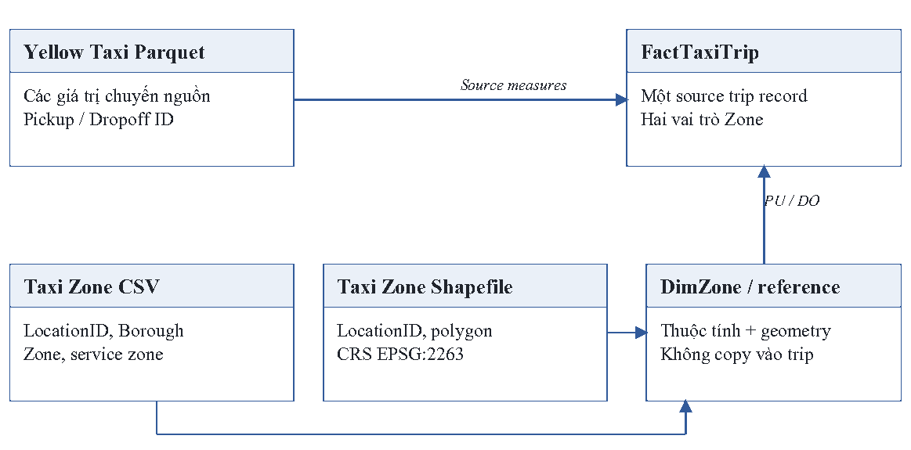
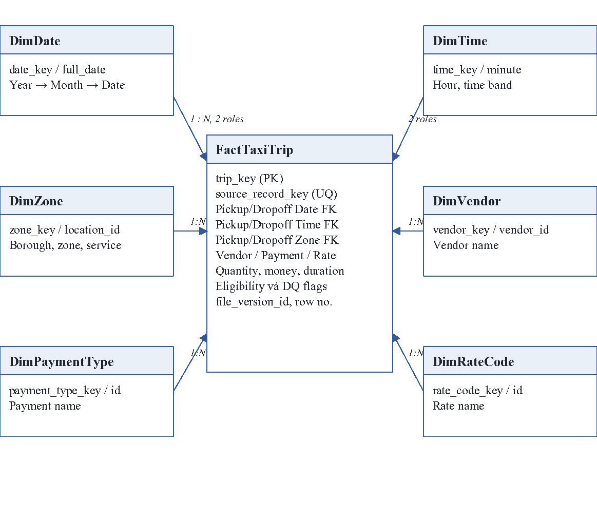
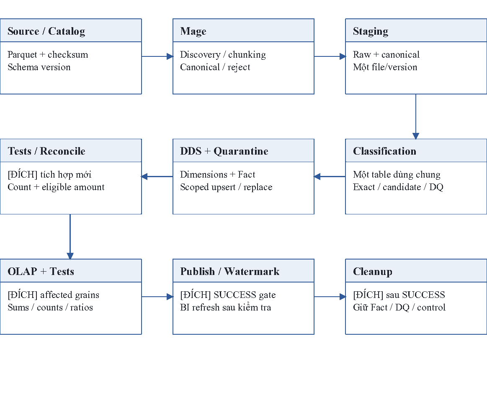

# BÁO CÁO TỔNG HỢP DATA WAREHOUSE VÀ ETL NYC YELLOW TAXI

ĐẠI HỌC QUỐC GIA THÀNH PHỐ HỒ CHÍ MINH

TRƯỜNG ĐẠI HỌC KHOA HỌC TỰ NHIÊN - KHOA CÔNG NGHỆ THÔNG TIN

Môn học: Hệ thống thông tin phục vụ trí tuệ kinh doanh

Nhóm thực hiện: Nhóm 2 | Năm học: 2026-2027

Giai đoạn 1: Khảo sát và thiết kế kho dữ liệu

Giai đoạn 2: Triển khai ETL, kiểm thử và tối ưu

Phiên bản tổng hợp ngày 19/11/2026 - TP. Hồ Chí Minh

## THÔNG TIN NHÓM VÀ PHẠM VI BIÊN SOẠN

| STT | MSSV | Họ và tên | Vai trò theo báo cáo gốc |
|---|---|---|---|
| 1 | 23120189 | Hoàng Quốc Việt | Thành viên |
| 2 | 23120209 | Lê Hoàng Nhật Anh | Trưởng nhóm |
| 3 | 23120237 | Lê Lâm Trí Đức | Thành viên |
| 4 | 23120336 | Nguyễn Thanh Phương | Thành viên |

Thông tin nhân sự kế thừa từ báo cáo giai đoạn 1 [S01]. Phân công cũ gồm yêu cầu phân tích/grain, khảo sát/kiểm chứng/báo cáo, dimensions/ETL/DQ và fact/measures. Chưa có bảng phân công cá nhân giai đoạn 2 được xác nhận trong hồ sơ khảo sát, vì vậy báo cáo không tự phân bổ hoặc tái sử dụng mức đánh giá 100% của giai đoạn 1 cho công việc ETL. Bài làm và việc biên tập tài liệu có sự hỗ trợ của AI; số liệu phải được kiểm soát bằng evidence dự án.

Theo yêu cầu biên soạn, tài liệu trình bày hệ thống tổng thể với giả định năm cụm công việc T00-T12 đã hoàn thành ở mức kiến trúc đích. Giả định này phục vụ mô tả đầy đủ quy trình từ nguồn đến công bố dữ liệu, không thay thế trạng thái source code, migration hoặc kết quả thực nghiệm. Các nội dung được phân loại xuyên suốt như sau.

| Nhãn | Ý nghĩa sử dụng trong báo cáo |
|---|---|
| [KS] | Kết quả khảo sát nguồn đã có tài liệu, bảng profile hoặc evidence lịch sử |
| [CODE] | Đã có code/configuration được quan sát; không tự suy ra đã chạy thành công |
| [QA] | Có kết quả kiểm thử được lưu, trong phạm vi dữ liệu và môi trường được nêu |
| [ĐÍCH] | Mô tả hệ thống hoàn thiện theo giả định T00-T12; chưa mặc định được source/evidence hiện tại xác nhận đầy đủ |
| [CHƯA ĐO] | Chưa có dữ liệu đo hoặc nghiệm thu tương ứng; không thay bằng số ước đoán |

Nguồn khảo sát là working tree hiện tại của `NYC_TAXI_BI_PROJECT`, nhánh `feature/control-metadata-watermark`, HEAD `c679360` cùng các thay đổi chưa commit, bao gồm DDS tối giản. Do đó HEAD chỉ nhận diện baseline, không đại diện toàn bộ phiên bản biên soạn. Tài liệu này không chạy lại pipeline, thay source code, migrate hoặc cập nhật metadata live.

## TÓM TẮT

Báo cáo phát triển nghiên cứu mô hình hóa NYC Yellow Taxi thành một tài liệu thống nhất về thiết kế và hiện thực ETL. Giai đoạn 1 khảo sát bảy file Parquet đại diện giai đoạn 2009-2026, tổng cộng 60.108.247 dòng, kết hợp Taxi Zone Lookup và Shapefile. Schema thay đổi theo thời gian, các khoản phí có thời điểm xuất hiện khác nhau, và dữ liệu chứa timestamp bất thường, passenger thiếu, khoảng cách không hợp lệ cũng như mismatch giữa tổng tiền và thành phần. Những phát hiện này trở thành căn cứ cho canonical schema, DQ và mô hình đa chiều [S01, S02].

Phạm vi triển khai giai đoạn 2 được cụ thể hóa thành 24 file của hai năm 2024-2025. Hệ thống sử dụng Mage để điều phối/trích xuất và chuẩn hóa kỹ thuật; PostgreSQL/PostGIS quản lý staging, metadata và kho; dbt thực hiện phân loại nghiệp vụ, resolve surrogate keys và nạp DDS. FactTaxiTrip có grain một source trip record được chấp nhận sau kiểm tra chất lượng và loại bản trùng chính xác trong cùng file. Sáu dimensions được bảo toàn cùng các vai trò pickup/dropoff.

Hướng tối giản giảm tính toán lặp bằng một classification table dùng chung theo file/version, chuyển fingerprint sang dữ liệu tạm, chuẩn hóa lineage qua file metadata và dùng upsert giữ khóa nguồn. Kiểm chứng DDS trên PostgreSQL 18 QA đã xác nhận fixture, retry, replacement và các tình huống lỗi được chỉ định. Tuy nhiên, kiểm chứng này không tương đương backfill 24 tháng trên PostgreSQL 16/PostGIS. Những chức năng tích hợp tests/OLAP/runner và vận hành đầy đủ được trình bày ở trạng thái đích, kèm bảng phân biệt phần đã có code/evidence và phần chưa xác nhận. Báo cáo chưa công bố thời gian hoàn tất dbt một tháng, mức tăng tốc hay tổng dung lượng kho hai năm khi chưa có phép đo tương ứng.

Từ khóa: Data Warehouse, Star Schema, NYC Yellow Taxi, ETL, dbt, Mage, Data Quality, Incremental Loading, Reconciliation.

## DANH MỤC TỪ VIẾT TẮT

| Thuật ngữ | Diễn giải |
|---|---|
| BI / DDS | Business Intelligence / Dimensional Data Store |
| ETL / ELT | Extract-Transform-Load / Extract-Load-Transform |
| DQ / QA | Data Quality / Quality Assurance |
| PK / FK / SK | Primary Key / Foreign Key / Surrogate Key |
| SCD | Slowly Changing Dimension |
| TLC | New York City Taxi and Limousine Commission |
| LSET / CET | Last Successful Extraction Time / Current Extraction Time |
| WAL | Write-Ahead Log |
| Grain | Mức chi tiết mà một dòng fact đại diện |

## 1. MỞ ĐẦU VÀ PHƯƠNG PHÁP

### 1.1. Bối cảnh và mục tiêu

Dữ liệu chuyến taxi cho phép nghiên cứu nhu cầu đi lại, phân bố doanh thu và sự thay đổi hành vi sử dụng dịch vụ theo thời gian, không gian, nhà cung cấp và hình thức thanh toán. Tuy nhiên, tập hợp nhiều file tháng không tự tạo thành một kho dữ liệu đáng tin cậy. Nếu không kiểm soát grain, trùng dữ liệu, miền mã và điều kiện KPI, cùng một báo cáo có thể đếm lặp chuyến, phân bổ sai doanh thu hoặc tính trung bình sai khi thay đổi cấp tổng hợp.

Mục tiêu thứ nhất là xây dựng lược đồ đa chiều có thể truy nguyên từ yêu cầu nghiệp vụ. Mục tiêu thứ hai là hiện thực đường đi Source → Staging → DDS với chất lượng dữ liệu, lineage, nạp tăng dần và khả năng chạy lại. Mục tiêu thứ ba là đánh giá tính đúng đắn và chi phí xử lý trên bằng chứng đã có, đồng thời xác định điều kiện cần thiết để nghiệm thu hệ thống hoàn thiện.

### 1.2. Ba phạm vi dữ liệu cần phân biệt

Khảo sát lịch sử sử dụng bảy tháng đại diện trải dài 2009-2026; đây không phải toàn bộ dữ liệu đã nạp DDS. Phạm vi file triển khai là hai năm 2024-2025, không phải bộ lọc loại các chuyến có ngày pickup ngoài hai năm đó. Phạm vi kiểm thử gồm các Parquet 5.000 dòng, fixture nghiệp vụ và bộ fixture tối giản 38 dòng; các tập này không thay thế benchmark tháng đầy đủ [S02-S05].

Phân biệt ba phạm vi giúp tránh hai diễn giải sai: xem tổng số dòng được profile là số dòng Fact đã nạp; hoặc dùng một chuyến lệch tháng file làm lý do tự động loại record hợp lệ khỏi kho.

### 1.3. Cách thu thập và đánh giá bằng chứng

Báo cáo được xây dựng bằng cách đọc 29 trang báo cáo gốc, đối chiếu các profile nguồn, mapping, SQL DDL/control functions, pipeline Mage, dbt models/materializations, QA scripts và logs lưu trong project. Khi tài liệu và code khác nhau, phần mô tả hiện thực ưu tiên working tree; tài liệu cũ được dùng để giải thích quá trình thay đổi, không xem là bằng chứng rằng chức năng còn đang được kích hoạt.

Evidence được phân theo phiên bản và môi trường. Chẳng hạn, kết quả 165 tests của fixture legacy không được cộng với số tests của nhánh tối giản để tạo một tỷ lệ thành công chung. `run_results.json` cũng có thể bị ghi đè bởi lệnh seed hoặc parse cuối, nên kết quả toàn kịch bản phải dựa vào script assertions, chuỗi log và metadata của đúng lượt chạy [S07, S08].

## 2. KHẢO SÁT NGUỒN VÀ HỆ QUẢ THIẾT KẾ

### 2.1. Ba nguồn dữ liệu

| Nguồn | Định dạng và khóa liên kết | Vai trò trong kho |
|---|---|---|
| Yellow Taxi Trip Records | Parquet theo tháng; pickup/dropoff LocationID ở phạm vi triển khai | Sự kiện giao dịch và measures nguyên tử |
| Taxi Zone Lookup | CSV, LocationID | Borough, tên zone và service zone |
| Taxi Zone Shapefile | SHP/SHX/DBF/PRJ/CPG, LocationID | Ranh giới không gian cho bản đồ và reference geometry |

LocationID là khóa liên kết thuộc tính và geometry, không phải khóa định danh chuyến. Pickup và dropoff dùng hai vai trò của cùng tập zone. Với dữ liệu 2009-2010 đã khảo sát, tọa độ cần được chuyển đổi CRS và point-in-polygon để suy ra zone; đó là hướng mở rộng lịch sử, không phải bước spatial join đã áp dụng cho toàn bộ 24 file 2024-2025.

### 2.2. Phương pháp và quy mô khảo sát [KS]

Lần khảo sát ngày 30/10/2026 ghi nhận 216 vị trí năm-tháng trong giai đoạn 2009-2026, 204 anchor phù hợp và 12 vị trí chưa có anchor trong HTML. Thiếu anchor không đồng nghĩa file không tồn tại: catalog triển khai sau đó đã có các file 2024-01 đến 2024-03. Báo cáo giữ kết quả crawl như một quan sát tại thời điểm khảo sát, không trình bày thành tình trạng hiện hành của TLC [S01, S02, S03].

PyArrow đọc footer/schema/row-group statistics; DuckDB tính tổng hợp, percentile và DQ bằng quét file; GeoPandas/Shapely được dùng cho khảo sát hình học. SHA-256 nhận diện nội dung file và hỗ trợ kiểm tra tính toàn vẹn. Các số liệu dưới đây kế thừa hồ sơ khảo sát, không phải lượt chạy lại trong quá trình viết báo cáo.

| File đại diện | Dung lượng Parquet (byte) | Số dòng | Số cột |
|---|---|---|---|
| 2009-01 | 469.759.995 | 14.092.413 | 18 |
| 2010-01 | 515.402.953 | 14.863.778 | 18 |
| 2015-01 | 175.325.767 | 12.741.035 | 19 |
| 2019-01 | 110.439.634 | 7.696.617 | 19 |
| 2024-04 | 59.133.625 | 3.514.289 | 19 |
| 2025-01 | 59.158.238 | 3.475.226 | 20 |
| 2026-01 | 64.165.080 | 3.724.889 | 20 |

Bảy file có tổng 60.108.247 dòng và 1.453.385.292 byte Parquet nén. Đây là dung lượng nguồn đại diện, không phải kích thước PostgreSQL hoặc ngân sách lưu trữ hai năm. Metadata nullability mô tả khả năng nhận null của schema; null count mới phản ánh null quan sát được ở dữ liệu.

### 2.3. Schema evolution

| Giai đoạn khảo sát | Thay đổi chính | Hệ quả triển khai |
|---|---|---|
| 2009-2010 | Tên cột, timestamp string, tọa độ và mã string | Mapping lịch sử riêng, spatial enrichment nếu mở rộng |
| 2015 | Timestamp và LocationID trong mẫu; improvement surcharge | Join zone trực tiếp; phân biệt cột chưa tồn tại |
| 2019 | Một số mã/passenger dạng double; congestion surcharge | Cast có kiểm soát, không áp miền mã chỉ theo hình thức số |
| 2024 | Integer width thay đổi; Airport_fee khác case | Chuẩn hóa tên airport_fee và kiểu canonical |
| 2025-2026 | Thêm cbd_congestion_fee, schema 20 cột | Mapping v002, kiểm thời điểm hiệu lực và missing component |

Canonical schema không union theo vị trí cột. Schema fingerprint phải dựa trên thứ tự tên và logical types, sau đó tra registry để nhận diện version. Giai đoạn 2 hiện tập trung v001/v002 của 2024/2025; chưa có bằng chứng triển khai canonicalization hoàn chỉnh cho mọi schema từ 2009 đến 2026 [S03, S06].

### 2.4. Zone và dị thường quan trọng

CSV có 265 dòng; Shapefile có 263 feature, CRS EPSG:2263. Hồ sơ khảo sát ghi geometry null/empty/invalid đều bằng 0. Hai LocationID 264 và 265 là business special members không có polygon tương ứng, không được đồng nhất với technical Unknown key 0. Với bản đồ web có thể tạo derivative EPSG:4326; không ghi đè geometry gốc hoặc tự gán zone gần nhất cho điểm ngoài polygon.

| Phát hiện khảo sát | Dẫn chứng được giữ lại | Quyết định tác động tới ETL |
|---|---|---|
| Thiếu passenger | 408.576/3.514.289 dòng mẫu 2024-04; 540.149/3.475.226 ở 2025-01 | Giữ null/flag, dùng tập eligible; không impute 0 |
| Mismatch tiền | Hồ sơ ghi khoảng 30,57% ở 2024-04 và 31,99% ở 2025-01 theo rule khảo sát | Không tự coi reported total sai; tách missing component và tolerance |
| Duration/speed outlier | P99 speed mẫu 2024-04 khoảng 34,84 mph, nhưng maximum phi thực tế | P99 phục vụ quan sát; chốt ngưỡng nghiệp vụ riêng |
| Exact duplicate | Số dư 31/16/229 ở ba mẫu 2009/2010/2015; bốn mẫu sau ghi 0 | Không suy cả nguồn không trùng; giữ kiểm in-file |
| Tháng/ngày ngoại kỳ | Footer 24 file ghi min 2002-12-31, max 2026-01-05 | Calendar rộng hơn 2024-2025; không lọc theo năm pickup |

Hai tỷ lệ mismatch tiền dùng các rule khảo sát lịch sử và không được diễn giải là tỷ lệ AMT-007 của pipeline mới. Footer min/max 24 file là quan sát metadata ngày 19/11/2026, không phải min/max của tập accepted sau DQ [S02, S08].

## 3. YÊU CẦU PHÂN TÍCH VÀ MÔ HÌNH ĐA CHIỀU

### 3.1. Business process, grain và identity

Business process là hoạt động một chuyến Yellow Taxi, từ pickup đến dropoff, được ghi nhận trong một source trip record. Grain vật lý của trusted Fact là một source record ACCEPTED hoặc WARNING sau phân nhánh DQ và loại exact duplicate dư trong cùng file. Không dùng fingerprint nghiệp vụ làm trip ID vì nguồn không cung cấp trip ID chính thức.

`source_record_key = SHA256(lower(file_sha256) || ':' || decimal(source_row_number))` là identity phục vụ idempotency. `trip_key` là bigint identity do DDS cấp; source key có unique constraint. File/version metadata cho phép truy lại tên file, schema và dòng nguồn. Một source key còn hiện diện trong Fact giữ trip_key khi retry. Khi một record đã bị loại khỏi Fact rồi được chấp nhận lại, mode tối giản không duy trì archive để phục hồi khóa cũ; khi đó có thể cấp trip_key mới [S04, S05].

Phân nhánh chất lượng không làm thay đổi grain. Technical reject, business quarantine và duplicate loser không biến mất khỏi hệ thống; chúng được lưu ở DQ cùng lý do. Hai source records khác file có nội dung giống nhau không tự động được xem là một chuyến duy nhất.

### 3.2. Ma trận yêu cầu phân tích

| Yêu cầu | Dimensions/role | Measures và đường truy vấn |
|---|---|---|
| Chuyến, hành khách theo ngày/tháng/năm | Date pickup; drill Year/Quarter/Month/Date | SUM(trip_count), passenger eligible sum |
| Doanh thu borough/vendor theo ngày, giờ | Pickup Zone, Vendor, Date, Time | SUM(revenue_amount); pickup là mặc định |
| Payment theo khu vực/tháng | PaymentType, Zone, Date | Số chuyến theo payment và kỳ lịch |
| Pickup/dropoff theo giờ, weekday, tháng | Hai role Date/Time/Zone | Count theo đúng FK của vai trò |
| Nhóm hành khách, biểu phí, distance | RateCode, Date/Time và derived bands | SOLO, SMALL_GROUP, LARGE_GROUP; khoảng cách |
| Dashboard khu vực và bản đồ | Zone + geometry reference | Chuyến/doanh thu theo zone và vai trò |
| Top N tuyến | PickupZone + DropoffZone | Tổng chuyến và xếp hạng theo context |
| Tip rate/speed theo rate | RateCode | Ratio-of-sums trên eligible set tương ứng |
| May/June, MoM, YoY | Date liên tục | Revenue, trips và chênh lệch theo kỳ |
| Revenue tăng nhưng trips ổn định | Vendor/Rate/Zone/Route/Time | Revenue/trip và phân rã components |

### 3.3. Sáu dimensions và Star Schema

Quan hệ logic là 1:N từ dimension đến Fact. Date, Time và Zone là conformed dimensions dùng hai vai trò pickup/dropoff. Trong semantic layer có thể dùng role views để giữ các relationship active rõ ràng; dữ liệu vật lý không cần nhân đôi dimension. Repo Power BI hiện chỉ có các thư mục giữ chỗ, nên role views/relationships trên dashboard được xem là tổ chức đích, chưa phải semantic model đã nghiệm thu.

| Dimension | Khóa và thuộc tính hiện thực | Ghi chú cập nhật so với thiết kế ban đầu |
|---|---|---|
| DimDate | date_key YYYYMMDD, full_date, year/quarter/month/day/isodow | Calendar liên tục; month name/weekend có thể derive, không tự coi đã lưu vật lý |
| DimTime | time_key = minute_of_day + 1; hour/minute/time_band | 1.440 business minutes; không dùng HHMM làm khóa hiện thực |
| DimZone | zone_key, location_id, borough, zone_name, service_zone | Geometry ở reference/source riêng, không sao chép trên từng trip |
| DimVendor | vendor_key/vendor_id/vendor_name | Mã hiện có 1, 2, 6, 7; không hardcode chỉ hai vendor |
| DimPaymentType | key/id/name | Phân biệt mã 0 Flex Fare và mã 5 business Unknown với key 0 kỹ thuật |
| DimRateCode | key/id/name | Giữ các code 1-6 và 99 theo seed mapping |

Mỗi dimension có key 0 = Unknown và -1 = Not Applicable. LocationID 264/265 vẫn được map surrogate dương. Kho giữ natural codes không map được để có thể điều tra; không thay natural value thành 0 rồi mất thông tin gốc.

Báo cáo gốc để mở SCD Type 2/effective-dated mapping cho dữ liệu nhiều thời kỳ. Trong phạm vi 2024-2025 và một reference snapshot, quyết định hiện tại là SCD Type 1 cho Zone/Vendor/Payment/Rate. Đây là thay đổi có chủ đích theo phạm vi, không phải tuyên bố đã hiện thực lịch sử thay đổi ranh giới hoặc nghĩa mã [S04, S05].

### 3.4. Fact và khả năng tổng hợp

Mode tối giản có 47 cột Fact trong schema QA. Các nhóm gồm identity/lineage ngắn, chín role/dimension keys, timestamps/natural codes, passenger/distance/duration, các khoản tiền, DQ và năm eligibility flags. `duration_seconds` là đơn vị lưu vật lý, thay cho duration_minutes ở thiết kế sơ bộ. `row_speed_mph` hỗ trợ rule/debug, không là measure additive để cộng hoặc lấy trung bình máy móc.

| Measure | Công thức sử dụng | Điều kiện và tính tổng hợp |
|---|---|---|
| Tổng chuyến | SUM(trip_count) | Mỗi trusted row có trip_count = 1 |
| Hành khách | SUM(passenger_count) trên tập eligible | Không impute null; không đếm passenger invalid vào KPI |
| Revenue | SUM(revenue_amount) | Reported total dương, accepted/warning |
| Revenue/trip | Revenue / số chuyến cùng tập phân tích | Non-additive, xử lý mẫu số 0 |
| Recorded-card tip rate | SUM(tip_amount) / SUM(fare_amount) | Trusted, payment=1, fare>0, tip>=0 |
| Speed mph | SUM(distance)*3600 / SUM(duration_seconds) | Cùng speed-eligible set |
| Average duration | SUM(duration_seconds) / eligible_count | Không average các average đã tổng hợp |
| MoM/YoY | (Giá trị kỳ hiện tại - kỳ so sánh) / kỳ so sánh | Dùng calendar và context thống nhất |

Revenue mặc định phân bổ theo pickup zone; dropoff là góc nhìn khác phải được ghi nhãn. Các negative/reversal, void hoặc high-severity reject không vào revenue trusted, nhưng còn được giữ ở DQ. Vì vậy doanh thu không phải tổng reported amount của tất cả raw rows. Phân rã Revenue = Trips × Revenue per Trip hỗ trợ lý giải biến động; chưa có kết quả phân tích May/June toàn bộ hai năm để kết luận nguyên nhân thực tế [S01, S04].

## 4. KIẾN TRÚC TRIỂN KHAI VÀ CÁC TẦNG DỮ LIỆU

### 4.1. Kiến trúc tổng thể [CODE, ĐÍCH]

Mage đảm nhiệm discovery, checksum/schema validation, extraction window, streaming chunks, canonicalization kỹ thuật và staging export. PostgreSQL/PostGIS lưu control, raw/canonical staging, geometry, DQ, DDS và OLAP. dbt thực hiện enrichment nghiệp vụ, classification, dimension lookup, Fact/DQ load và các mô hình phân tích. Power BI dùng DDS/OLAP thay vì đọc trực tiếp raw files.

Source → Staging → DDS là kiến trúc dữ liệu chính; raw và canonical là các biểu diễn phục vụ landing/staging, không tự tạo thêm một tầng kho tích hợp NDS bắt buộc. DQ là chức năng xuyên suốt, không là thao tác xóa dữ liệu trước khi nạp.

| Vùng lưu | Đối tượng tiêu biểu | Vòng đời và trách nhiệm |
|---|---|---|
| File nguồn | Parquet, CSV, Shapefile và catalog/checksum | Bất biến để tái tạo; không ghi đè khi chuẩn hóa |
| stage | yellow_taxi_raw, yellow_taxi_canonical, zone raw/geometry | Một file/version đang xử lý; reference riêng |
| control | etl_batch, etl_file, watermark, log, step/replacement/version metadata | Dài hạn để điều phối và truy vết |
| dq | technical, business, duplicate quarantine; reconciliation | Lý do reject và thông tin cần điều tra |
| dds | Sáu dimensions, fact_taxi_trip, classification workspace và analysis view | Fact/dim persistent; classification transient |
| olap | Daily/monthly zone/monthly route aggregates | Phục vụ phân tích, rebuild theo affected grains |

Không đồng nhất Parquet raw trên filesystem với `stage.yellow_taxi_raw` trong PostgreSQL. Cả hai đều giữ giá trị nguồn, nhưng bản trong database là working input có vòng đời cleanup, còn file bất biến là nguồn tái tạo.

### 4.2. Môi trường và giới hạn kiểm chứng

Docker Compose định nghĩa PostgreSQL/PostGIS và Mage; profile host dùng cổng khác cổng nội bộ container. Evidence control năm 2026 ghi PostgreSQL 16.9/PostGIS 3.5; Mage validation ghi Mage 0.9.76. dbt logs/QA dùng dbt 1.8.7 và adapter postgres 1.8.2. QA DDS tối giản mới dùng PostgreSQL 18.6 độc lập trên máy Windows, không phải container production [S06-S08].

Sự khác nhau giữa PostgreSQL 16 và 18 cần được giữ trong kết luận. Kiểm chứng schema/transaction/hash trên 18 là bằng chứng hữu ích cho code, nhưng không tự chứng minh integration typed Parquet, PostGIS và toàn pipeline trên 16. Báo cáo không coi Docker đang dừng tại một thời điểm khảo sát là nguyên nhân của sự cố lịch sử.

## 5. TRÍCH XUẤT, CHUẨN HÓA VÀ SCHEMA EVOLUTION

### 5.1. Discovery, checksum và extraction window

Catalog triển khai liệt kê 24 file 2024-2025 với URL, local path, content length, SHA-256, schema fingerprint/version và trạng thái validation. Discovery phải phân biệt known identity thành công với filename mới, version mới hoặc attempt thất bại. Điều kiện window dùng LSET < source_updated_at ≤ CET; CET được chụp ở đầu batch và chỉ trở thành watermark thành công sau downstream gates [S03, S06].

Checksum đổi dưới cùng tên file là một revision cần xử lý có kiểm soát, không là quyền mặc định xóa version cũ. Metadata old/new version binding ghi rõ yêu cầu replacement; source key vẫn dựa file content và row number, không dùng thời điểm chạy làm định danh dòng.

### 5.2. Xử lý theo chunk và staging export [CODE]

`load_source_files.py` dùng `ParquetFile.iter_batches`, tạo số dòng nguồn liên tục qua các phần và gắn lineage trước khi xuất work files. Canonicalization và validation xử lý trên từng phần bị chặn kích thước thay vì giữ cả 24 tháng trong một DataFrame. Kích thước chunk là tham số vận hành; báo cáo không tự chọn một giá trị benchmark tối ưu nếu chưa đo.

`stage_loader.py` chuẩn bị frame theo target types, thực hiện COPY vào quan hệ tạm và cơ chế chống nạp trùng theo source key. Nullable integers phải được serialize thành dạng số nguyên hoặc SQL NULL, không thành chuỗi kiểu “1.0” sai hợp đồng integer. Exporter kiểm bảng đã tồn tại, ghi step state và cập nhật heartbeat theo tiến độ; nó không được tự thay thế schema bằng suy luận kiểu DataFrame [S06].

### 5.3. Canonical schema và lỗi kỹ thuật

| Nhóm | Chuẩn canonical | Bảo toàn ngữ nghĩa |
|---|---|---|
| Timestamp | timestamp without time zone | Giờ local New York; không tự gắn UTC |
| Vendor/payment/rate/location/passenger | smallint sau cast hợp lệ | Natural code còn giữ để map Unknown/điều tra |
| Khoảng cách | numeric(10,3), miles | Không dùng giá trị rounded làm raw-exact hash |
| Tiền | numeric(12,2), USD | Không thay null component bằng 0 một cách chung chung |
| Store flag | Y/N/null | Normalize case/space; lỗi cần được truy về nguồn |
| Lineage | batch/version/source row/key/schema/checksum | Liên kết bất biến và retry được |

Timestamp/location/total không cast được hoặc required-null được tách technical quarantine theo Mage canonical contract. Business anomaly như passenger 0 hoặc speed cao không tự trở thành lỗi kỹ thuật. Raw malformed values được giữ trong technical payload; canonical accepted không cần sao chép toàn JSON nếu raw source còn truy được.

Structural absence và observed null khác nhau. Năm 2024 không có CBD field theo schema v001; năm 2025 v002 có cột nhưng giá trị null là một quan sát dữ liệu. Khi tính component sum, structural CBD absence được tính 0 trong phép cộng phù hợp; cột expected mà null làm trạng thái NOT_RECONCILABLE, không bị che bằng COALESCE toàn bộ phí thành 0.

### 5.4. Reference và geometry

Loader CSV cần giữ literal `N/A` của TLC để không biến business member 264/265 thành null. Với Mage, GeoDataFrame không tương thích một số thao tác preview JSON; implementation chuyển geometry thành WKT giữa các block và khôi phục GeoDataFrame/CRS trước khi nạp PostGIS. Evidence reference integration ghi nhận 265 lookup rows, 263 geometries ở SRID 2263, chỉ 264/265 không có polygon [S06].

Source geometry được dùng cho bản đồ; không cần spatial join từng chuyến của 2024-2025 khi LocationID đã có. Mở rộng sang 2009-2010 đòi kiểm tọa độ, biến đổi CRS và lưu riêng native/derived zone, match count và boundary policy; chưa được tính là chức năng ETL lịch sử đã hoàn thiện trong evidence hiện có.

## 6. DATA QUALITY, DUPLICATE VÀ QUARANTINE

### 6.1. Phân loại thống nhất

Ưu tiên phân nhánh là TECHNICAL_REJECT → DUPLICATE → BUSINESS_QUARANTINE → WARNING → ACCEPTED. Mỗi source row có một nhánh cuối trong đối soát, nhưng có thể có nhiều rule IDs. Warning được nạp Fact; eligibility từng KPI được quyết định độc lập, không suy trực tiếp từ disposition chung.

| Nhóm rule | Điều kiện tiêu biểu theo config hiện tại | Hành động |
|---|---|---|
| TIME | Dropoff ≤ pickup; duration >1.440 phút | Business quarantine |
| TIME warning | Duration >180 đến 1.440 phút; pickup month khác file | Giữ Fact, hạn chế KPI duration/speed khi cần |
| DIST/SPEED | Distance âm; speed >80 mph | Business quarantine |
| DIST/SPEED warning | Distance null/0; speed >45 đến 80 mph | Giữ và loại khỏi speed eligible set |
| PASS | Null, <1 hoặc >6 | Warning, không impute, passenger KPI chỉ 1-6 |
| LOC/CODE | Không map; store flag không hợp lệ | Warning/Unknown technical key; giữ natural values |
| VOID | Payment code 6 | Business quarantine |
| AMOUNT | Total ≤0, component âm, tip âm hoặc lớn hơn total | Business quarantine theo rules |
| Component consistency | Diff ≤0,01; >0,01 đến 0,05; >0,05; thiếu component | MATCHED; ROUNDING; REVIEW; NOT_RECONCILABLE |
| FEE | CBD dương trước 05/01/2025 | Business quarantine theo hợp đồng |
| Airport | Fee dương ngoài PU 132/138 | Warning, không auto-quarantine |

Các ngưỡng là quyết định nghiệp vụ trong config hiện tại, không phải suy trực tiếp từ P99. Mismatch component đơn thuần không là lý do loại revenue; reported total vẫn là nguồn revenue của trusted positive trip. Passenger quá ngưỡng là warning trong implementation, không sửa thành hard reject vì suy luận chủ quan.

### 6.2. Ba khái niệm identity và duplicate

Source key trả lời “đây có phải dòng nguồn đã nạp lại hay không”. Raw-exact fingerprint trả lời “các giá trị nguồn theo ordered schema có giống nhau hay không”. Candidate fingerprint chỉ chỉ ra “hai record có một tập thuộc tính nghiệp vụ gần định nghĩa giống nhau”. Ba khái niệm này không thay thế nhau.

Raw-exact serialization giữ ordinal/type, null markers, byte length UTF-8, schema fingerprint prefix và 19/20 source fields. Trong cùng file checksum, occurrence nhỏ nhất theo source_row_number là survivor, các occurrence dư đi duplicate quarantine. Record khác precision gốc nhưng cùng numeric canonical không được coi exact duplicate chỉ vì canonical rounded bằng nhau.

Trong mode tối giản, candidate tám field chỉ tính trong query/workspace, ghi flag khi có nhiều canonical records cùng candidate trong file và tổng hợp số dòng/nhóm. Candidate-only match không tự thêm warning, không auto-delete và không thay eligibility. Cross-file registry, matching toàn lịch sử và cập nhật hồi tố DUP-002 không thuộc runtime tối giản. Đây là giới hạn được chấp nhận để giảm chi phí, không phải bằng chứng rằng dữ liệu hai năm không có duplicate giữa file [S04, S05, S08].

### 6.3. Quarantine và retention

Technical quarantine giữ lỗi cast và raw malformed values. Business quarantine giữ canonical diagnostics, các khoản tiền và reasons; duplicate quarantine bổ sung survivor source key và occurrence. Trong schema tối giản, hai bảng business/duplicate không giữ JSON và hashes persistent. Source file/version + row number cho phép truy lại bản Parquet bất biến khi điều tra.

Cleanup chỉ áp dụng staging/workspace sau SUCCESS và scope/writer checks; không xóa Fact, DQ hoặc metadata. Khi batch lỗi, dữ liệu điều tra được giữ. Việc ngừng ghi archive/registry không đồng nghĩa được xóa ngay các bảng legacy đã tồn tại hoặc đã thu hồi disk space [S05].

## 7. HIỆN THỰC DDS VÀ NẠP TĂNG DẦN

### 7.1. Một classification workspace [CODE, QA]

Chuỗi view legacy có thể khiến enrichment, JSON serialization, hashing, window sort và DQ lookup được tính lại khi Fact, DQ, dimension hoặc tests đọc. Nhánh tối giản materialize classification một lần theo batch/version. Fingerprint model là ephemeral SQL, không tạo thêm physical relation. Output chỉ giữ các cột cần cấp Fact/DQ và các contract diagnostics, thay vì SELECT * toàn bộ payload ra bảng vật lý.

Preflight kiểm scope toàn raw/canonical staging, metadata identity/schema, đúng một STAGED attempt và trạng thái batch writable. Điều này cần thiết vì chỉ thêm WHERE batch_id ở cuối query có thể che staging bị lẫn batch. Workspace có marker batch/version/valid; trước rebuild, marker được invalidate độc lập. Nếu rebuild thất bại, bảng cũ còn để điều tra nhưng Fact/DQ không được dùng marker không hợp lệ. Table build và marker valid được hoàn tất cùng giao dịch khi đạt constraints.

Classification table có source-key uniqueness, index version/disposition và ANALYZE. Candidate summary lưu một dòng nhỏ theo batch/version, thay cho registry từng chuyến. Table swap có thể làm mất các view phụ thuộc bảng cũ; vì vậy pipeline phải dựng lại accepted/analysis views theo DAG đầy đủ, không chọn riêng một node rồi coi dependency đã sẵn sàng [S05, S08].

### 7.2. Dimensions có cache

Materialization `minimal_reference` tính signature từ compiled SQL/config và các reference dependencies nhỏ. Khi signature không đổi, dữ liệu dimension và refreshed_at không bị ghi lại. Khi reference đổi, cập nhật Type 1 được thực hiện mà không tự rekey natural code đã tồn tại. Phát hiện surrogate mapping drift phải dừng để có migration riêng.

Date được khởi tạo theo config 2002-01-01 đến 2026-12-31, bao phủ footer bounds của 24 file; QA ghi 9.133 members kể cả 0/-1. Time có 1.440 minute members và 0/-1. Không quét accepted để tính lại min/max Date mỗi batch. Nếu gặp ngày hợp lệ ngoài range, Fact dừng trước mutation và yêu cầu mở rộng calendar; không âm thầm gán Unknown. Cơ chế không cho thu hẹp calendar hiện có bảo vệ các khóa ngày đã được sử dụng.

### 7.3. Fact upsert và DQ replace theo file

`minimal_fact` tạo temp source, unique index và statistics; xóa stale accepted keys trong đúng version và upsert source records vào Fact trong transaction. Cùng source key đang tồn tại giữ trip_key. Row hoàn toàn không đổi không bị UPDATE; QA đối chiếu cả source→trip_key và xmin để xác nhận hành vi này.

`minimal_file_replace` thay tập business/duplicate quarantine của processing version, kể cả khi tập mới rỗng. Thay vì delete theo tháng pickup hoặc toàn bảng, scope là immutable file version. Identity collision sang version khác bị từ chối. Khi target hiện hữu có columns/types không khớp schema mới, materialization fail để yêu cầu migration, không tự full-refresh Fact hoặc drop columns.

Lineage text/checksum/schema được chuẩn hóa qua file metadata; Fact giữ các ID ngắn cần thiết. `v_fact_taxi_trip_analysis` join metadata và derive passenger/distance/time bands, row tip rate hoặc aliases cần cho lớp phân tích. Điều này giữ đường truy vấn nghiệp vụ mà không nhân bản các chuỗi mô tả trên mọi trip.

### 7.4. Skip, retry và replacement trong hệ thống hoàn thiện [ĐÍCH]

| Trường hợp | Hành vi đích | Điều kiện đúng đắn |
|---|---|---|
| File mới | Stage và chạy DDS/tests/OLAP cho version mới | Checksum/schema/scope hợp lệ |
| SUCCESS, checksum không đổi | Skip trước dbt | Pending cleanup phải được xử lý riêng |
| FAILED/STAGED cùng version | Dựng lại workspace và retry downstream | Không dùng workspace stale, không tăng watermark sớm |
| Filename cũ, SHA đổi | Dừng chờ replacement binding tường minh | Không coi discovery là quyền retire bản cũ |
| Replacement đã chấp thuận | Retire old version, load new, giữ file khác | Capture old/new affected grains và retry được |
| Cleanup lỗi sau SUCCESS | Chỉ retry cleanup | Không nạp lại Fact đã commit |

Code control/runner legacy và custom DDS đã cung cấp nhiều nền tảng cho bảng trên. Tuy nhiên, runner hiện còn hardcode archive, seed/test theo luồng cũ; mặc định `dbt_minimal_mode=false`. Toàn bộ cơ chế skip/init/cleanup phối hợp với DDS mới là nội dung hoàn thiện đích theo T08, không được coi đã tích hợp chỉ vì custom materializations chạy fixture thành công [S05, S09].

## 8. ĐỐI SOÁT, KIỂM THỬ VÀ ĐIỀU PHỐI HOÀN CHỈNH

### 8.1. Các bất biến đối soát

Source rows = Canonical rows + Technical reject rows.

Canonical rows = Fact rows + Business quarantine rows + Duplicate rows + Intentionally excluded rows.

Các nhánh cuối không được đếm lặp; intentionally excluded mặc định bằng 0 nếu không có policy và reason rõ. Candidate diagnostic count không cộng vào excluded. Khi total/fare/tip không cast được, đối soát tiền phải tách eligible numeric count và eligible sum theo từng field; không ép amount không đọc được thành zero hợp lệ.

Revenue được đối chiếu với reported positive total của tập trusted eligible, không phải tổng source amount bao gồm rejects. Số chuyến theo kỳ, phân bố payment, survivor links, FK mapping và tổng numerator/denominator của KPI cần được kiểm bên cạnh tổng dòng, vì count đúng vẫn có thể đi kèm money hoặc role mapping sai.

### 8.2. Phân tầng tests [CODE, QA, ĐÍCH]

| Cấp kiểm tra | Phạm vi | Kết quả/chứng cứ cần giữ |
|---|---|---|
| Source/reference | File/schema/checksum, lookup/geometry | Catalog, schema version, rejected file reason |
| Technical staging | Cast, required values, source identity, row balance | Canonical/reject counts và raw malformed values |
| Classification | Rule/disposition, exact survivor, candidate diagnostic | Full batch checks, không thay bằng sample |
| DDS | PK/unique, FK, membership, measure eligibility | Orphan count = 0, row/amount balances |
| OLAP | Affected grain parity, disappeared groups, sufficient statistics | So aggregate với Fact cùng context |
| Recovery | Fault, rollback/roll-forward, retry, watermark, cleanup | Trạng thái trước/sau và đúng error message |
| Full audit | Checkpoint/cuối 24 file | Completeness, global uniqueness/FK, tổng counts/amounts |

Thiết kế đích gom các điều kiện null/flag thành ít lần scan khi vẫn giữ diagnostics; tests chỉ cần lịch sử được chuyển sang full audit. Điều này không cho phép hạ errors thành warning, bỏ reconciliation hoặc thêm LIMIT làm mất lỗi ngoài sample. Các legacy tests phụ thuộc cột/hash/history đã bỏ được gate trong minimal mode, cần được thay thế đồng bộ trước khi công bố pipeline mới.

### 8.3. Trình tự công bố dữ liệu [ĐÍCH]

Trình tự hoàn thiện là: khởi tạo context/CET → verify source/scope → reference init nếu cần → staging → classification/DDS → batch tests/reconciliation → OLAP → OLAP tests → commit SUCCESS và watermark → cleanup. SUCCESS và watermark thuộc một metadata transaction; failure trước đó giữ LSET cũ.

Một dbt build không phải một transaction duy nhất. Fact có thể rollback đúng transaction riêng trong khi DQ model đã commit trước đó. Vì vậy recovery giữa models là roll-forward theo cùng input bất biến; BI chỉ refresh khi publication gate đạt. Không tuyên bố mọi reader truy cập trực tiếp persistent tables đều thấy atomic snapshot nếu chưa có cơ chế xuất bản tách biệt.

Single writer bảo vệ staging/workspace; advisory transaction lock trong từng materialization không thay khóa toàn pipeline. Heartbeat giúp nhận diện job treo; STALE không tự đồng nghĩa có thể xóa dữ liệu hoặc ép SUCCESS. Scheduler/trigger phải gọi cùng control path với chạy thủ công, không bỏ các gates để rút ngắn demo.

### 8.4. OLAP affected grains [ĐÍCH]

Daily aggregate theo pickup_date phải tính lại trên tất cả Fact của ngày bị tác động, bao gồm record đến từ file khác. Nếu chỉ aggregate current file rồi overwrite cả ngày, các chuyến thuộc file khác sẽ bị mất trong reporting. Replacement phải chụp affected dates/source months từ old và new trước mutation, sau đó xóa/rebuild các nhóm tương ứng; nhóm biến mất không được giữ stale.

DDS mới đã lưu `dbt_minimal_affected_grains` trước Fact mutation. Các OLAP models legacy còn hiện diện nhưng bị disabled trong minimal mode để không đọc các physical columns đã chuẩn hóa khỏi Fact. Ba aggregate daily/monthly zone/monthly route là nền tảng; đường Fact analysis view vẫn cần cho các chiều phân tích chưa có trong aggregate. Hoàn thiện T07/T08 theo giả định báo cáo bao gồm sửa các truy vấn, kiểm sufficient statistics và publication gate; chưa có evidence integration minimal OLAP đầy đủ để trình bày như kết quả thực đo.

## 9. TỐI ƯU HIỆU NĂNG VÀ DUNG LƯỢNG

### 9.1. Nút thắt được quan sát

Log tải thật legacy ghi dim_date 251,51 giây; fingerprint history 599,76 giây với INSERT 3.723.833 dòng; Fact lỗi sau 901,28 giây và mất kết nối PostgreSQL. Lượt dbt run thất bại sau 1.153,83 giây. Các node có thể chạy song song nên không cộng các thời gian này để tính tổng tháng; lượt lỗi không là benchmark hoàn tất [S10].

Số thứ tự test 141 không định danh cố định: evidence có 141/165 là unique_dim_vendor_vendor_key chạy nhanh, còn 141/176 là file_month_and_cbd_consistency ở trạng thái SKIP. Muốn xác định nghẽn phải dùng node name/unique_id, invocation và query/wait state. Server closed connection chưa đủ để kết luận hết RAM, hết disk hoặc lỗi SQL cụ thể.

### 9.2. Các quyết định tối ưu đã hiện thực [CODE, QA]

| Quyết định | Cơ chế giảm chi phí | Giới hạn kết luận |
|---|---|---|
| Classification table dùng chung | Tính hash/ranking/DQ một lần cho consumer | Chưa có hệ số tăng tốc tháng đầy đủ |
| Ephemeral fingerprint | Không lưu physical fingerprint workspace thứ hai | SQL vẫn phải tính hash trong build |
| Bỏ history registry/archive trong mode mới | Tránh bản sao từng trip và historical matching | Legacy tables chưa tự được thu hồi dung lượng |
| Normalize file lineage | Bỏ text/schema/checksum lặp trên Fact | Analysis view cần join metadata |
| Reference cache | Không ghi lại dimensions không đổi | Runner init invocation vẫn cần tích hợp tối ưu |
| Scoped upsert/replace | Retry không nhân bản, clear stale có phạm vi | Skip trước dbt thuộc integration đích |
| Index và ANALYZE | Hỗ trợ source-key/version joins và estimates | Không thêm mọi index tùy ý |

Physical QA snapshot ghi Fact 47 cột, classification 44, business DQ 27 và duplicate DQ 29; không có JSON trong bốn bảng này, không có physical fingerprint relation. Đây là bằng chứng cấu trúc lưu trữ, không phải phép đo phần trăm giảm byte trên dữ liệu tháng. Index, row width, TOAST, WAL và temporary spill đều có thể ảnh hưởng peak.

### 9.3. Phương pháp benchmark và capacity planning [ĐÍCH, CHƯA ĐO]

So sánh baseline và bản tối giản cần cùng immutable input, trạng thái database ban đầu, tài nguyên, lifecycle semantics và mức concurrency. Tách first load, retry và SUCCESS-unchanged skip. Ghi thời gian toàn phase và từng node/test; không dùng riêng thời gian tạo view để đánh giá công việc tính dữ liệu bên dưới.

Permanent footprint gồm Fact/DQ/dimensions/metadata/OLAP/index; peak còn gồm staging, classification, temp relations/spill, WAL và file/work/backup cùng tồn tại. Database size không bao quát toàn WAL hoặc allocated VHDX; không cộng database lần nữa vào VHDX đã chứa nó. `temp_bytes` là counter lượng ghi tích lũy, không phải peak temp đang chiếm disk.

Không nhân transient peak một tháng với 24 nếu cleanup tuần tự. Ngược lại, không ngoại suy chỉ từ kích thước Parquet nén. Mage slim-v2 đã có full-month QA riêng: `load_stage` 107,110 giây cho 2024-05 và 125,800 giây cho 2025-05; người dùng cũng đã chạy thành công hai tháng trên UI. Chưa có benchmark Mage + dbt/DDS cùng điều kiện, vì vậy không suy thời gian Source → DDS từ số đo Source → STAGED.

### 9.4. Ma trận dữ liệu hiệu năng cần bổ sung

| Chỉ tiêu | Trạng thái xác nhận | Dữ liệu cần cập nhật |
|---|---|---|
| dbt hoàn tất một tháng trên mode tối giản | CHƯA ĐO | Wall-clock và run results theo phase |
| Mức tăng tốc so baseline/feat-fix-dbt | CHƯA ĐO | Hai lượt so cùng input/DB/resources |
| Heap/TOAST/index Fact/DQ của tháng thật | CHƯA ĐO | pg_total_relation_size và per-index sizes |
| Peak host disk/WAL/temp/workspace | CHƯA ĐO | Time series trong lúc chạy và sau cleanup |
| Forecast cuối hai năm | CHƯA XÁC NHẬN | Permanent growth + transient peak + headroom |
| Benchmark threads/memory tối ưu | CHƯA ĐO | Query plan, spill, RAM và throughput cùng điều kiện |

## 10. KẾT QUẢ TRIỂN KHAI VÀ ĐÁNH GIÁ BẰNG CHỨNG

### 10.1. Evidence hạ tầng, control và staging

Hồ sơ task 4.3 ghi control validation PASS trên PostgreSQL 16.9/PostGIS 3.5: năm bảng, 18 functions và 15 explicit indexes ở checkpoint đó. Watermark failure giữ nguyên; missing required steps hoặc reconciliation mismatch bị chặn; concurrent session phải chờ lock rồi bị active-batch gate từ chối. Đây là kiểm chứng control tại một phiên bản, không phải số lượng objects toàn project sau các migrations tiếp theo [S06].

Hồ sơ task 4.5 xác nhận năm staging/DQ relations, canonical schema 33 cột tại checkpoint ban đầu, constraints và 15 secondary indexes theo bộ yêu cầu lúc đó. Chạy DDL hai lần cho thấy idempotency; smoke upsert cùng một source row hai lần vẫn giữ một dòng. Migrations tối ưu về sau có thể thay index set, nên không dùng số 15 như hiện trạng live không đổi.

Mage task 4.4 có checkpoint 11 tests, sau các sửa reference/preview lên 13 tests theo tài liệu cập nhật. Reference integration xác nhận 265 lookup rows, 263 geometries, SRID 2263. Full-month ingestion 2024-05/2025-05 đến STAGED đã được kiểm chứng; kết quả này vẫn không tự chứng minh dbt/DDS end-to-end, watermark và cleanup đã hoàn tất.

### 10.2. Kết quả fixture end-to-end legacy

`OPTIMIZATION_PROGRESS.md` và storage QA logs ghi hai file sample, mỗi file 5.000 dòng. Batch 2024 có 4.911 Fact và 89 business DQ; batch 2025 có 4.449 Fact và 551 business DQ. Tổng 9.360 Fact và 640 business DQ; technical/duplicate reject tự nhiên bằng 0 trong hai sample này. Replay sau cleanup giữ số Fact và distinct keys, cùng hash ánh xạ source→trip_key theo evidence [S07].

Các lượt legacy test 165/165 và OLAP fixture/recovery được dùng làm bằng chứng về luồng phiên bản cũ trong QA. Không xem 0 duplicate ở sample là kết quả của toàn bộ 24 file; không áp kết quả archive/registry legacy cho mode tối giản đã bỏ các cơ chế đó.

### 10.3. Kết quả DDS tối giản [QA]

Lượt QA Cụm 2 dùng PostgreSQL 18.6 riêng; dbt 1.8.7 và adapter 1.8.2. Harness giới hạn port/database/user QA, không dùng profile production. Bộ input gồm 38 raw records trong sáu scopes, expected literals được chốt trước implementation và giữ nguyên checksum. Technical routing được adapter cung cấp theo fixture specification; đây không phải lượt chạy Mage [S08].

| Scope fixture | Raw | Canonical | Fact | Technical | Business | Duplicate | Revenue USD |
|---|---|---|---|---|---|---|---|
| A_2024 | 29 | 24 | 17 | 5 | 6 | 1 | 222,03 |
| B_2025 | 6 | 6 | 5 | 0 | 1 | 0 | 85,00 |
| C_CROSS_FILE | 1 | 1 | 1 | 0 | 0 | 0 | 13,00 |
| A_REPLACEMENT | 1 | 1 | 1 | 0 | 0 | 0 | 13,00 |
| EMPTY_VALIDATED_SCOPE | 0 | 0 | 0 | 0 | 0 | 0 | 0,00 |
| ALL_REJECTED | 1 | 0 | 0 | 1 | 0 | 0 | 0,00 |

Các scopes trên là những kịch bản riêng; không cộng A và A_REPLACEMENT như hai file active đồng thời. Sau A+B+C có 23 Fact, revenue 320,03 USD. Replacement chỉ A bằng R còn bảy Fact, revenue 111 USD; file B/C giữ khóa. Ngày pickup chung 2024-05-01 vẫn có hai trips/26 USD từ B/C, là expected dataset cho kiểm OLAP affected-grain tiếp theo.

Suite cuối có 25 dbt invocations: 13 success và 12 negative failures đúng error message, kèm assertions dữ liệu/rollback. Sáu selected legacy tests và 11 offline contract tests PASS. Các số đếm invocation/test này thuộc các tầng khác nhau, không cộng thành một tỷ lệ chất lượng duy nhất. Zero-row scope là downstream fixture, không sửa quy tắc ingestion đang từ chối Parquet rỗng.

| Tình huống | Quan sát QA |
|---|---|
| Retry cùng dữ liệu | trip_key và xmin của Fact không đổi |
| Reference không đổi/đổi mô tả | Cache không ghi lại; Type 1 update đúng khi reference đổi |
| Natural-code rekey hoặc calendar shrink | Bị chặn, không tự migration |
| Revision chưa binding | Bị chặn trước retirement |
| Trigger gây lỗi INSERT sau scoped delete | Fact transaction rollback; retry sau bỏ trigger thành công |
| Missing raw field/rule mapping; mixed scope | Classification không thành công và marker invalid |
| Fact gọi với workspace sai/invalid | Bị chặn |
| Ngày valid ngoài calendar | Fail đúng calendar guard, không phải chỉ một lỗi bất kỳ |
| Target legacy extra column | Fail schema guard, không auto-drop |
| All-reject/zero incoming | Clear stale scoped Fact/DQ, không xóa toàn kho |

Legacy registry/history sentinel tables không bị đọc/ghi bởi runtime tối giản. Điều này xác nhận khả năng tách dependency, không xác nhận đã xóa archive cũ hay giảm VHDX trên máy triển khai.

### 10.4. Trạng thái thực và trạng thái hoàn thiện giả định

| Cụm công việc | Source/evidence quan sát | Trình bày hệ thống đích khi giả định hoàn tất |
|---|---|---|
| T00-T02 | Inventory, contract, fixtures/oracle, expected literals | Nền yêu cầu và tiêu chí nghiệm thu thống nhất |
| T03-T05 | DDS opt-in đã code và SQL QA; chưa migrate live | Classification, cached dimensions, scoped Fact/DQ là lõi kho |
| T06-T08 | Có legacy tests/OLAP/runner; integration minimal còn phải sửa | Batch/full audit, affected OLAP, skip/retry/cleanup và publication được tích hợp |
| T09-T11 | Có QA/fault evidence cục bộ; thiếu benchmark tháng/cutover minimal 16 | Migration/rollback, E2E target, benchmark và tuning theo evidence |
| T12 | Có tài liệu triển khai/handoff; chưa evidence nghiệm thu full 24 tháng | Runbook, full audit, vận hành và bàn giao hoàn chỉnh |

Giả định hoàn tất năm cụm không cho phép đổi trạng thái thực trong repository thành DONE hoặc đặt một bảng “PASS 24 tháng” không có log. Báo cáo cung cấp mô tả đích đầy đủ để phát triển tài liệu hai giai đoạn ngay lúc này, nhưng chỉ những dòng có evidence mới được đọc là kết quả thực nghiệm.

## 11. HẠN CHẾ VÀ ĐIỀU KIỆN NGHIỆM THU HỆ THỐNG ĐÍCH

### 11.1. Giới hạn phạm vi và dữ liệu

Chưa có bằng chứng nạp đủ 24 tháng vào trusted DDS tối giản và hoàn tất full audit. Khảo sát bảy file không đại diện chất lượng mọi tháng; min/max footer không thay accepted-row validation. Historical spatial mapping 2009-2010 vẫn là hướng mở rộng, không phải ETL đã triển khai cho mọi năm. Candidate in-file không phát hiện mọi duplicate giữa files.

SCD Type 1 phù hợp snapshot hiện tại nhưng không bảo toàn lịch sử thay đổi nghĩa code/ranh giới. Recorded-card tip rate không đại diện tất cả tiền boa vì cash tips không được ghi đầy đủ. Weighted speed là chỉ tiêu trên tập eligible, không suy rộng cho mọi record nguồn. Những giới hạn này phải được nêu cùng dashboard để người đọc không diễn giải vượt dữ liệu.

### 11.2. Giới hạn tích hợp và vận hành

Mode dbt tối giản vẫn là phạm vi riêng và các OLAP models legacy được tách khỏi đường DDS. Mage staging đã cutover live sang `slim-v2` trên PostgreSQL 16/PostGIS bằng migration 008–010; typed Parquet/full-month integration đã PASS đến STAGED. Schedule publication end-to-end và dbt/DDS vẫn phải được kiểm riêng.

Thành công transaction Fact không đồng nghĩa thành công toàn DAG. Consumer đọc trực tiếp bảng có thể thấy trạng thái trung gian trước watermark; cơ chế BI refresh gate phải được triển khai và kiểm. Legacy tables và backups còn tồn tại làm dung lượng thực khác schema mới tạo từ đầu. Chưa có số đo peak và forecast dung lượng tin cậy cho toàn hai năm.

### 11.3. Hồ sơ nghiệm thu cần bổ sung khi cập nhật báo cáo

| Hạng mục | Chứng cứ tối thiểu để cập nhật thành kết quả xác nhận |
|---|---|
| Nạp đủ hai năm | 24 file/version SUCCESS, checksum/schema, counts và full audit |
| Retry/skip | Run logs, nguồn→trip_key parity, không nạp lại SUCCESS unchanged |
| Replacement | Binding old/new, unrelated-version parity, disappeared-group correctness |
| E2E tối giản | Mage → DDS → tests → OLAP → watermark → cleanup trên target 16/PostGIS |
| Hiệu năng/dung lượng | Benchmark đồng điều kiện, permanent deltas và peak time series |
| Schedule và dashboard | Trigger/schedule evidence, publication gating, semantic model/visual kiểm chứng |
| Bàn giao | Runbook có target/profile/scope rõ; backup/rollback và retention được xác nhận |

Các ô chưa có số liệu được giữ là CHƯA ĐO/CHƯA XÁC NHẬN, không điền số giả để hoàn chỉnh hình thức. Khi có evidence mới, cập nhật đúng phần kết quả, không thay giả định thiết kế bằng một tuyên bố vận hành đã xảy ra.

## 12. KẾT LUẬN

Đóng góp giai đoạn 1 là liên kết khảo sát nguồn với grain chuyến, sáu dimensions, role-playing keys và measures có khả năng tổng hợp đúng. Giai đoạn 2 chuyển các quyết định này thành canonical staging, DQ/quarantine, metadata control và các materializations dbt có kiểm thử. Nhánh tối giản tập trung vào những chức năng cần cho đồ án: xử lý đúng file/version, bảo toàn source identity, phân nhánh DQ, resolve dimension keys và cung cấp dữ liệu phân tích có thể đối soát.

Hệ thống hoàn thiện theo giả định T00-T12 bao gồm đầy đủ orchestration, scoped tests, OLAP affected grains, publication, cleanup, capacity measurement và runbook. Bằng chứng hiện có xác nhận nhiều thành phần và DDS fixture QA, nhưng chưa đủ khẳng định hoàn tất full two-year run, mức tăng tốc cụ thể hoặc dung lượng cuối. Phân biệt rõ thiết kế đích và quan sát thực nghiệm là điều kiện để báo cáo có thể được cập nhật mà vẫn duy trì tính học thuật và khả năng kiểm tra lại.

## TÀI LIỆU VÀ BẰNG CHỨNG THAM CHIẾU

[S01] Nhóm 2. Báo cáo mô hình hóa kho dữ liệu - Thiết kế Star Schema cho NYC Yellow Taxi. `D:/BI/DATH/2_BaoCao.pdf`, 29 trang. Dùng để kế thừa nội dung giai đoạn 1; bản gốc được giữ nguyên.

[S02] Hồ sơ khảo sát: `profiling/outputs/reports/NYC_Yellow_Taxi_Source_Survey_and_Data_Quality_Report.md`; `profiling/outputs/profiles/02_parquet_file_profile.csv`, `03_schema_by_file.csv`, `04_schema_evolution.csv`; bảng DQ và mappings trong cùng outputs. Số liệu khảo sát được dẫn theo checkpoint, không chạy lại trong nhiệm vụ biên soạn.

[S03] Catalog triển khai: `data/catalog/yellow_taxi_2024_2025.csv`, `yellow_taxi_schema_registry.csv`; `docs/mapping/INPUT_FILES_2024_2025.md`.

[S04] Quyết định và hợp đồng: `docs/decisions/PHASE2_DESIGN_FREEZE_PROPOSAL.md`, `docs/mapping/DBT_HANDOVER_CONTRACT.md`, `docs/etl_design/DBT_MINIMAL_CONTRACT.md`. Cần đọc thông báo legacy/minimal để phân biệt phạm vi.

[S05] Code dbt working tree: `dbt_project/dbt_project.yml`; models staging/intermediate/marts/quality; `macros/minimal_scope.sql`, `minimal_reference.sql`, `minimal_file_materializations.sql`; `docs/etl_design/DBT_MINIMAL_CLUSTER2_IMPLEMENTATION.md`.

[S06] Mage và SQL: `mage_project/transformers/load_source_files.py`, `utils/canonical.py`, `utils/stage_loader.py`, exporters/pipeline metadata; `sql/control`, `sql/stage`, `sql/migrations`; evidence `PHASE2_4_3_CONTROL_VALIDATION.md`, `PHASE2_4_4_MAGE_PIPELINE_VALIDATION.md`, `PHASE2_4_5_STAGING_SCHEMA_INDEX_VALIDATION.md` trong `evidence/test_results`.

[S07] Legacy QA: `OPTIMIZATION_PROGRESS.md`; `evidence/run_logs/storage_qa/task3_*.log`, `task4_replacement_recovery_retry.log`. Kết quả theo fixture/phiên bản, không cộng lẫn với mode tối giản.

[S08] DDS minimal QA: `reports/dbt_minimal_refactor/cluster2/results.json`, `physical_schema.json`, `calendar_metadata.json`, `README.md`, `verification.txt`, `legacy_sql_and_unit_tests.log` và per-invocation logs; `tests/fixtures/dbt_minimal`, `tests/expected_results/dbt_minimal_*.json`; reports T00-T05. `results.json` là index của lượt cuối, không lấy log phát triển cũ ngoài index làm verdict.

[S09] Orchestration hiện có: `deployment/scripts/run_24_month_backfill.py`, migrations `006_backfill_recovery_and_cleanup.sql`, `007_replacement_recovery.sql`; kế hoạch đích `docs/etl_design/DBT_MINIMAL_REFACTOR_TASK_PLAN.md`.

[S10] Rà soát runtime: `reports/DBT_PERFORMANCE_BRANCH_REVIEW_2026-11-19.md` và `dbt_project/logs/dbt.log`. Runtime lỗi 19 phút 14 giây là lượt legacy thất bại, không là benchmark tháng hoàn tất.

Nguồn ngoài kế thừa từ báo cáo gốc: TLC Trip Record Data, Yellow Taxi Data Dictionary, TLC User Guide, Working With Parquet, Taxi Zone Lookup/Shapefile; Kimball và Ross, The Data Warehouse Toolkit, ấn bản 3, Wiley, 2013. Báo cáo này không tuyên bố đã kiểm tra lại phiên bản online hiện hành của các tài liệu đó.

## PHỤ LỤC A. DATA DICTIONARY FACT TỐI GIẢN

| Nhóm | Cột vật lý và kiểu | Ghi chú |
|---|---|---|
| Identity | trip_key bigint identity; source_record_key char(64) | PK và unique source identity |
| Lineage | file_version_id, source_row_number, batch_id bigint | File metadata join; batch là lần thực sự ghi row |
| Date/Time | pickup/dropoff_date_key integer; pickup/dropoff_time_key smallint | Hai role cùng dimension vật lý |
| Các FK khác | pickup/dropoff_zone_key, vendor_key, payment_type_key, rate_code_key integer | Non-null, Unknown member phù hợp |
| Natural codes | vendor_id, rate_code_id, payment_type_id, pu_location_id, do_location_id smallint | Giữ unmatched natural values |
| Thời gian | pickup_datetime, dropoff_datetime timestamp; duration_seconds integer | Local NY, duration narrow sau DQ |
| Quantity | trip_count smallint; passenger_count smallint; trip_distance_miles numeric(10,3) | trip_count=1; null passenger không impute |
| Money | fare_amount, extra, mta_tax, tip_amount, tolls_amount, improvement_surcharge, total_amount, congestion_surcharge, airport_fee, cbd_congestion_fee numeric(12,2) | Components nguyên tử |
| Derived | calculated_total_amount, revenue_amount numeric(12,2); row_speed_mph numeric(10,2) | Row diagnostics không cộng như KPI ratio |
| DQ | primary_disposition varchar(24), dq_rule_ids text[], component_reconciliation_status text | Fact chỉ accepted/warning |
| Eligibility | Năm cờ is_*_kpi_eligible boolean | Revenue, tip, speed, duration, passenger |
| Source flag | store_and_fwd_flag char(1) | Y/N/null |

File text, source month, checksum/schema và source_last_modified được tham chiếu từ metadata; reported_total_amount là alias của total_amount; row_tip_rate/bands derive qua analysis view. Không lặp raw JSON, hai fingerprints hoặc archive prior_fact trên physical Fact tối giản. Bảng trên mô tả nhóm cột, không là SQL migration có thể chạy trực tiếp.

## PHỤ LỤC B. CHUYỂN TIẾP TỪ BÁO CÁO GỐC

| Nội dung gốc | Xử lý trong báo cáo tổng hợp | Cơ sở |
|---|---|---|
| Khảo sát bảy file, ba nguồn | Giữ, ghi checkpoint và giới hạn đại diện | S01/S02 |
| Phạm vi lịch sử 2009-2026 | Tách khảo sát với triển khai 24 file 2024-2025 | Catalog và contract |
| Transaction grain, sáu dimensions | Giữ, làm rõ trusted membership/source identity | Actual models |
| Duration minutes, TimeKey còn mở | Đổi sang duration_seconds, minute_of_day+1 | Schema/models |
| SCD2/effective-dated còn đề xuất | Chốt Type1 trong phạm vi snapshot 2024-2025 | Decision freeze/contract |
| Revenue/reversal/duplicate còn cần chốt | Ghi policy/eligibility/exact survivor cụ thể | Config, seeds, classification |
| Spatial legacy | Giữ như mở rộng, không coi đã ETL đủ lịch sử | Phạm vi nguồn thực hiện |
| Lineage text ở Fact | Chuẩn hóa file metadata + analysis view | Slim Fact QA |
| Kiến trúc ETL sơ bộ | Bổ sung chunking, control, DQ, scope, retry/replacement | Mage/SQL/dbt/runner |
| Kiểm chứng thiết kế | Bổ sung ma trận QA, lỗi, tối ưu và phần chưa đo | Logs và fixture evidence |
| Phân công/đánh giá giai đoạn 1 | Giữ nhân sự; không tự đánh giá giai đoạn 2 | Chưa có xác nhận phân công mới |

## PHỤ LỤC C. KHUNG CẬP NHẬT KẾT QUẢ VẬN HÀNH

| Trường cần lưu cho mỗi lượt | Ý nghĩa và yêu cầu |
|---|---|
| Phiên bản code/mode/DB | Commit + working-tree snapshot, legacy/minimal, engine/adapter |
| Input | File/version/checksum/schema, số dòng và phạm vi ngày |
| Invocation/phase | Seed/reference/DDS/tests/reconciliation/OLAP/commit/cleanup |
| Verdict | PASS/EXPECTED_FAIL/FAIL, error message đúng nguyên nhân |
| Correctness | Counts, eligible sums, source→trip_key, FK, affected grains |
| Performance | Wall-clock, CPU/RAM khi có, query plan/spill |
| Storage | Relation/index/TOAST, WAL/temp activity, peak host/VHDX |
| Publication | Watermark trước/sau, SUCCESS, cleanup pending/complete |

Biểu mẫu này là cấu trúc hồ sơ cần thu thập, không phải dữ liệu đo đã được điền. Tài liệu có thể cập nhật khi T06-T12 được hiện thực/nghiệm thu mà không phải viết lại mô hình nghiệp vụ hoặc tạo một báo cáo giai đoạn 2 rời rạc.
